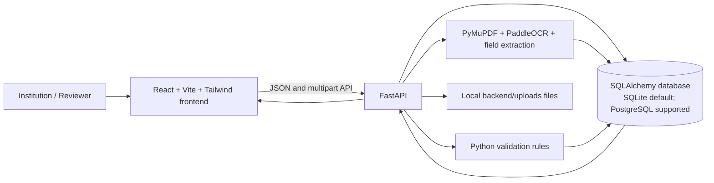

# Pramaan — Explainable document scrutiny for institutional applications

## 1. Project title and tagline

**SIH 2026 · Problem Statement 26261**

Pramaan — explainable preliminary scrutiny for institutional applications.


Pramaan is a prototype that extracts selected information from institutional application documents, runs explicit validation checks, and gives reviewers evidence-linked findings to inspect.

**Team and institution:** Not recorded in the repository yet. Add the verified SIH team name, member names, roles, and institution before public submission; no names are inferred here.

## 2. Problem statement

Institutional applications arrive with multiple supporting documents that reviewers must inspect manually. Checking whether required files are present, reading key fields, comparing information across documents, and recording a defensible scrutiny outcome takes time and can make inconsistencies harder to trace.

Pramaan addresses preliminary document scrutiny for one configured application category. It supports reviewers; it does not replace authorized decision-makers.

## 3. Our solution

Institutions can register, create an Extension of Approval (EoA) application, upload supporting documents, and run preliminary checks. Pramaan extracts selected text and fields, applies documented Python rules, and presents findings with source evidence and suggested next actions. A reviewer then records a decision, requests resubmission, or escalates where the workflow allows, and explicitly finalizes scrutiny.

## 4. Key features

- Institution accounts and application management for the configured EoA category.
- PDF, JPG, and PNG document upload with file and page limits.
- Selectable PDF text extraction with PyMuPDF and scanned-page/image OCR with PaddleOCR.
- Document-specific field extraction, raw text, confidence, and uncertainty status.
- Required-document presence, field-completeness, fire-certificate expiry, institution-name consistency, and additional rule checks implemented in the backend.
- Findings with rule IDs, statuses, reasons, linked documents, evidence, and next actions.
- Reviewer queue, filters, scrutiny decisions, finalization blockers, and a report built from persisted processing and validation results.

Checks are preliminary. A match or pass does not establish authenticity or regulatory approval.

## 5. Screenshots and demo video

No genuine product screenshots or published YouTube demo URL are currently present in the repository. Add screenshots captured from the running application (do not use mockups as product evidence) and the YouTube URL when available. Capture these states:

1. Institute dashboard / application list.
2. Document centre after processing the three synthetic documents.
3. Reviewer findings with the expired certificate evidence visible.
4. Reviewer decision dialog.
5. Final scrutiny report after a reviewer action.

The synthetic showcase dataset is described below and can be opened in the live application after seeding.

## 6. USP and differentiators

**Primary USP:** explainable, evidence-linked preliminary scrutiny. Each rule finding states what it checked and links the result to an uploaded document and extracted evidence where available, keeping the authorized reviewer in control.

Implemented differentiators include cross-document institution-name comparison, OCR uncertainty handling, distinct finding statuses, reviewer decisions, and finalization rules. The repository does not implement live issuing-authority verification, tamper-proof authenticity checks, or AI fraud detection.

## 7. End-to-end workflow

```text
Institution creates EoA application
  → uploads explicitly typed documents
  → backend extracts text and selected fields
  → Python rules check presence, fields, expiry, and consistency
  → findings and evidence are stored and shown
  → institution submits the application
  → reviewer inspects findings and records decisions / resubmission / escalation
  → reviewer finalizes scrutiny
  → completed report is available under the workflow's access rules
```

Submission is not approval. A report does not prove that a document is authentic.

## 8. System architecture



The API uses SQLAlchemy async sessions. Startup creates missing tables with `create_all`; the checked-in Alembic directory has no revision scripts. Uploaded binaries are local files; metadata, extraction results, and findings are stored in the configured database.

## 9. Technology stack

Verified from the current dependency manifests and application configuration:

- **Frontend:** React 19, Vite 7, Tailwind CSS 4, React Router 7.
- **Backend:** Python, FastAPI, Pydantic 2, SQLAlchemy 2 async.
- **Database:** SQLite with `aiosqlite` is the zero-setup default in `backend/.env.example` and `app/config.py`; PostgreSQL via `asyncpg` is supported/configurable and is the selected team project database in `docs/DECISIONS.md`.
- **Document processing:** PyMuPDF (`fitz`) and PaddleOCR 3.7.0 / PaddlePaddle 3.3.1.
- **Validation:** explicit custom Python rules.

## 10. Prerequisites

- Git.
- Node.js and npm compatible with the installed Vite 7 toolchain (the repository does not pin a Node.js version).
- Python 3.11 or newer per `backend/README.md`; PaddleOCR/PaddlePaddle platform wheel availability may constrain Python and operating-system combinations.
- SQLite is used by default. PostgreSQL is optional for local setup and required only when configuring the selected shared/team database.
- Network access on first PaddleOCR initialization may be needed to obtain model files.

## 11. Installation and setup

Clone the repository, then install the backend and frontend dependencies. Commands below use PowerShell on Windows; use the equivalent virtual-environment activation command on other platforms.

```powershell
git clone https://github.com/samvesh-cs/sih-prototype.git
cd sih-prototype

# Backend
cd backend
python -m venv .venv
.\.venv\Scripts\Activate.ps1
python -m pip install -r requirements.txt
Copy-Item .env.example .env

# Frontend (new terminal, from repository root)
cd frontend
npm install
Copy-Item .env.example .env.local
```

The backend template defaults to local SQLite at `backend/sih_prototype.db`; no database server setup is needed for a local demo. To use PostgreSQL, create a local database and set `DATABASE_URL` in `backend/.env`, for example:

```dotenv
DATABASE_URL=postgresql+asyncpg://sih_user:<url-encoded-password>@localhost:5432/sih_prototype
```

Use a private password and URL-encode reserved characters. Set a strong private `JWT_SECRET_KEY` for any non-local deployment; never commit `.env` or `.env.local`.

Start the backend in one terminal:

```powershell
cd backend
.\.venv\Scripts\Activate.ps1
uvicorn app.main:app --reload --port 8000
```

Start the frontend in another terminal:

```powershell
cd frontend
npm run dev
```

Open `http://localhost:5173`. The API is at `http://localhost:8000/api`; health check: `http://localhost:8000/health`; interactive API docs: `http://localhost:8000/docs` in debug mode. `frontend/.env.example` selects live API mode (`VITE_USE_MOCKS=false`).

## 12. Demo setup and sample credentials

The checked-in showcase uses synthetic sample PDFs from `backend/tests/demo_samples/manifest.json`. In the local backend environment, seed the accounts and one submitted showcase application:

```powershell
cd backend
.\.venv\Scripts\Activate.ps1
python scripts/seed_demo_showcase.py
```

The showcase uses application ID `app_demo_sih2026`, synthetic institution **Synthetic ABC Institute of Technology**, and academic year **2026-27**. It processes an expired synthetic Fire Safety Certificate plus valid synthetic Building Completion Certificate and Affidavit-2; the real OCR processor and validation rules generate the records. The seed refuses non-debug/non-SQLite targets and refuses to overwrite a partial application. Run the API and frontend, sign in as reviewer, and open the submitted application in the reviewer queue.

Default local seed credentials from `backend/app/config.py` (override with private environment variables when appropriate):

| Role | Email | Password |
|---|---|---|
| Reviewer | `reviewer@aicte-india.org` | `Reviewer@AICTE2026` |
| Demo institution | `institution@engg-college.edu.in` | `College@Pramaan2026` |

These are development credentials, not production accounts. The institution account owns the seeded application; reviewer login opens the scrutiny flow.

## 13. Example validation scenario

The synthetic showcase includes `expired_fire_safety.pdf`. The backend extracts the certificate expiry date and the `EXPIRY_001` rule compares it with the current date. If the extracted date is expired, the report flags the finding and includes the source text, normalized date, page number where available, and linked document. Other presence and completeness checks run against all three uploaded documents.

A reviewer can inspect the finding and source document, then record an available decision such as confirming a discrepancy, verifying it, requesting resubmission with notes, or escalating with notes. The decision remains a human scrutiny action; the flag alone does not decide approval.

## 14. Testing and verification

Commands available in the repository:

```powershell
# Backend
cd backend
.\.venv\Scripts\python -m pytest -v

# Frontend
cd ..\frontend
npm test
npm run lint
npm run build
```

At the time of this README update, frontend reviewer workflow tests pass (7 tests), lint completes with 0 errors and 1 existing Fast Refresh warning in `src/auth/AuthContext.jsx`, and the Vite production build succeeds. The backend suite has 77 collected tests, but execution in the current Windows runner stalls at the first async database test; it has not been verified as passing. The same runner also hangs on a minimal `asyncio.run(asyncio.sleep(0))` reproduction under its installed Python versions. Re-run the backend suite in a compatible Python environment before relying on it. These are observed results, not a guarantee for other environments.

## 15. Limitations

- One configured category: EoA. The checklist is a representative subset of three document types, not the complete regulatory application.
- Accepted uploads are PDF/JPG/PNG within configured size/page limits. OCR and regex-based field extraction can miss or misread content; low-confidence and missing values need human review.
- PyMuPDF extracts selectable PDF text; PaddleOCR handles scanned pages and images. OCR model/platform availability can affect first-run setup and processing.
- The backend currently defaults to local SQLite for zero-setup use, while PostgreSQL is supported. Deployment database operations, backup, and migration strategy are not production hardened.
- Uploaded files use local storage. No live issuing-authority integration, cryptographic authenticity verification, advanced fraud detection, multi-category workflow, or automated final approval/rejection is implemented.
- The browser-only mock mode uses synthetic placeholder behavior; its findings are not actual backend validation results.
- No genuine screenshots or published YouTube demo URL are checked into this repository yet.

## 16. Future scope

Potential follow-up work, subject to team agreement: complete the real API end-to-end rehearsal; add reviewed screenshot/video assets; broaden the official checklist carefully; improve evidence navigation from findings to source pages; expand OCR quality handling; and formalize PostgreSQL migrations and deployment storage. These are recommendations, not claims about current capabilities.

## 17. Repository structure

```text
backend/app/routes/       FastAPI routes
backend/app/services/     Application, document, validation, and report workflows
backend/app/ocr/          PDF/image processing and field extraction
backend/app/rules/        Explainable validation checks
backend/app/models/       SQLAlchemy models
backend/tests/            API/rule/OCR tests and synthetic PDFs
backend/scripts/          Account and showcase seed scripts
frontend/src/             React routes, screens, API client, and styles
docs/                     API contract, decisions, rulebook references, walkthrough
```

See [docs/PROJECT_WALKTHROUGH.md](docs/PROJECT_WALKTHROUGH.md) for the detailed request/data flow and [docs/API_CONTRACT.md](docs/API_CONTRACT.md) for request and response shapes.

## 18. References and acknowledgements

- SIH 2026 Problem Statement 26261 (include the official SIH listing URL in the public submission materials; it is not recorded in this repository).
- AICTE, *Approval Process Handbook 2024–2027*, Annexure-2, §2.1; the repository’s scoped notes and checklist source map are in [docs/AICTE_RULEBOOK_REFERENCE.md](docs/AICTE_RULEBOOK_REFERENCE.md).
- Library documentation: [React](https://react.dev/), [Vite](https://vite.dev/), [Tailwind CSS](https://tailwindcss.com/), [FastAPI](https://fastapi.tiangolo.com/), [SQLAlchemy](https://docs.sqlalchemy.org/), [PyMuPDF](https://pymupdf.readthedocs.io/), and [PaddleOCR](https://www.paddleocr.ai/).
- Synthetic demo PDFs and scenarios are maintained in `backend/tests/demo_samples/`.

## 19. Team and contact

Team name, member names, individual workstream assignments, institution, and public contact links have not been supplied in the repository. Add verified team information before submission. Do not publish private personal contact details without consent.

## 20. License

No license has been selected or recorded in this repository. All rights remain with their respective holders unless and until a license is added.