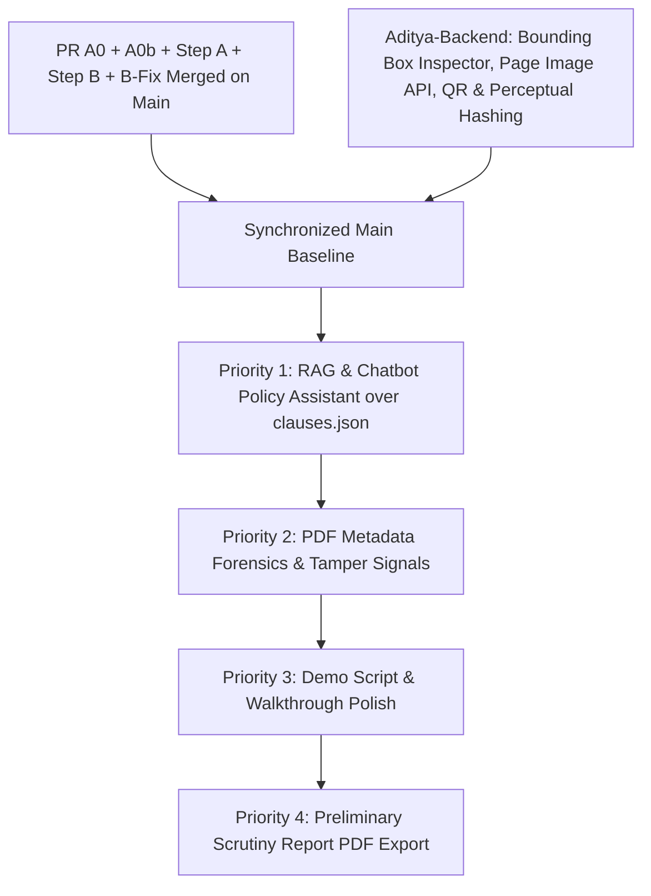

# CONSOLIDATED_IMPLEMENTATION_PLAN.md — Pramaan Architecture & Execution Plan (Steps A–H)
**SIH 2026 — Problem Statement 26261: Preliminary Document Scrutiny & Compliance Verification**  
*Document Version: 3.0 (Demo Fast-Track & Aditya Backend Synchronization) | Scope: Current Implementation Status, Aditya-Backend Features, and RAG/Chatbot Policy Assistant*  
*Status: PR A0, A0b, STEP A, STEP B MERGED. ADITYA-BACKEND (BOUNDING BOXES, PAGE-IMAGE API, QR, PERCEPTUAL HASH) VERIFIED & INTEGRATED. STEP C (BOUNDING BOX) SUPERSEDED. NEXT PRIORITY: RAG POLICY ASSISTANT & CHATBOT.*

---

## 1. Context, Completed Baselines & Branch Strategy

### 1.1 Confirmed Merged Baselines on `main`
- **PR A0 (Commit `16444ea`):** Neutralized live TER payment receipt check to advisory informational signal (D-019), enforced strict Scrutiny Committee Reviewer role authorization (D-021), and established tenant-isolated RBAC.
- **PR A0b (Commit `b32156d`):** 
  - Standardized citation of `competent_authority_letter` to **Annexure-2 §2.1 preamble and D-020 only** in `docs/API_CONTRACT.md` and `eoa_checklist.py`.
  - Implemented Decision (b): Over-50 building with Competent Authority letter returns `status="unresolved"`, `title="Competent Authority letter uploaded: reviewer to confirm it applies"`, citing Annexure-2 §2.1 preamble, with honest reason text emphasizing that Pramaan does not read the letter and does not determine government construction status.
  - Implemented next action: `"Reviewer to open the letter and confirm it applies."`
  - Removed all occurrences of `"complying with"` and `"No action required"` from finding text.
  - Extended honest-claims enforcement in `test_clause_registry.py` to ban `"complies"` and `"complying"` while keeping `"non-compliant"` strictly banned.
  - Full suite verified: **89 passed, 5 warnings** in backend pytest.
- **Step A: Shadow Declarative Engine & Advisory Attribute (Commit `f326cae`):**
  - Introduced explicit `advisory: bool = False` attribute to rule schemas and classes, decoupling overall-status calculation from hardcoded rule identifiers.
  - Asynchronous shadow declarative engine runner executing on a deep-copied in-memory context with zero database access in worker threads.
  - Controlled by `ENABLE_SHADOW_DECLARATIVE_ENGINE: bool = False` (default OFF).
- **Step B: Declarative Engine Cutover, Three-Valued Logic & Parity Harness (Commit `635e3fc`):**
  - Implemented Kleene three-valued logic (`TRUE`, `FALSE`, `UNKNOWN`) across atomic and compound operators (`all_of`, `any_of`, `not`).
  - Strict maximum condition nesting depth of 3 enforced at startup (D-017).
  - Configurable fallback flag `RULE_ENGINE_MODE = "legacy"` (default `"legacy"`).
  - Ruleset versioning recorded on every generated and stored report.
- **Fix B-Fix (Commit `6262d2e`, Merged `815b971`):**
  - Neutralized `TER_PAYMENT_001` in YAML to `status: "pending_review"`, `advisory: true`, `severity: "info"`; confirmed absent TER receipt emits **zero findings** in both engines.
  - Reverted unapproved strict ISO date parsing in `expiry_check.py` back to legacy multi-format loop (`%Y-%m-%d`, `%d-%m-%Y`, `%d/%m/%Y`, `%Y/%m/%d`), achieving 100% parity with declarative engine.
  - Expanded replay parity harness to **28 contexts and 233 rule checks**, achieving **100% parity (0 discrepancies)** across synthetic scenarios and edge-case boundary fixtures.
  - Verified non-advisory rules persist `advisory=False` and TER rules persist `advisory=True` through `/validate`.
  - Full suite passing: **139 passed, 5 warnings** in legacy mode and declarative mode.

### 1.2 Unified Integration Baseline (Commit `156d358`)
The `aditya-backend` branch and active feature branch have been formally integrated via merge commit `156d358` (`merge: integrate feat/f1-evidence-highlighting with aditya-backend features`).

The integrated baseline unifies:
1. **High-Resolution Page Image Rendering Endpoint (`backend/app/routes/documents.py`):**
   - `GET /api/applications/{id}/documents/{doc_id}/page-image?page={page_num}&dpi={dpi}`: Renders document pages to PNG via PyMuPDF (150 DPI) and exposes page width/height in response headers (`X-Page-Width`, `X-Page-Height`, `X-Image-Width`, `X-Image-Height`).
   - `GET /api/applications/{id}/documents/{doc_id}/pages-info`: Returns total page count and individual page dimensions for multi-page document navigation.
2. **Visual Evidence Inspector & Bounding Box Overlays (`frontend/src/App.jsx`):**
   - Interactive `DocumentViewerDrawer` with animated glowing bounding boxes (`bboxOverlay`), percentage coordinate mapping, line-level search rects (`page.search_for`), multi-page continuous scrolling, zoom controls (in/out/fit), inspector vs PDF toggle, and deficiency callouts for missing fields.
   - **Step C / F1 (Bounding Box Implementation) is complete and integrated.**
3. **Perceptual Image Hashing for Visual Duplicate Detection (`backend/app/ocr/perceptual_hash.py`):**
   - Implements difference hash (dHash) and perceptual hash (pHash) on rendered document pages to detect image reuse and duplicate diagrams across applications.
4. **Local QR Code Extraction & Verification (`backend/app/ocr/qr_processor.py`, `backend/app/rules/qr_verification_check.py`):**
   - Local QR code detection and parameter parsing (`certificate_number`, `institution_name`, `issue_date`) with zero outbound network calls (zero SSRF).
5. **Issuing Authority Verification (`backend/app/services/authority_verification.py`):**
   - Rule-based verification of issuing authorities against designated state authorities.
6. **Reviewer Scrutiny Lifecycle & Finalization:**
   - Reviewer decision payload builder, review status transitions (`review_completed`), and scrutiny finalization endpoint (`POST /api/applications/{id}/finalize-review`).
7. **Showcase Demo Seeder (`backend/scripts/seed_demo_showcase.py`):**
   - Complete synthetic dataset seeding script for demo walkthroughs.

---

## 2. Feature Flags, Ruleset Versioning & Workload Division

### 2.1 Per-Step Feature Flags & Ruleset Versioning
To maintain zero-risk incremental merges, each feature is guarded by explicit feature flags configured in `backend/app/config.py`:

| Flag Name | Default | Scope | Status | Notes |
| :--- | :--- | :--- | :--- | :--- |
| `ENABLE_SHADOW_DECLARATIVE_ENGINE` | `False` | Step A | Merged (`main`) | Default OFF. When True, runs DeclarativeRuleEngine asynchronously in-memory. |
| `RULE_ENGINE_MODE` | `"legacy"` | Step B | Merged (`main`) | `"legacy" \| "declarative"`. Kept as `"legacy"` for current demo stability. |
| `ENABLE_PAGE_IMAGE_RENDER` | `True` | Step C / F1 | Merged (`156d358`) | High-res PNG page rendering via PyMuPDF for visual bounding box overlay. |
| `ENABLE_PERCEPTUAL_HASHING` | `True` | Step D | Merged (`156d358`) | Detects re-used diagrams and cropped certificates via dHash / pHash. |
| `ENABLE_QR_VERIFICATION` | `True` | Step D | Merged (`156d358`) | Local QR decoding across query params, key-value, and JSON without SSRF. |
| `ENABLE_TAMPER_SIGNALS` | `True` | Step D | In Progress | Metadata forensics (producer strings, non-signature incremental update counts). |
| `ENABLE_RAG_ASSISTANT` | `True` | Step G / F2 | **ACTIVE PRIORITY** | Offline Policy Q&A Assistant over `clauses.json` with strict allow-list. |
| `ENABLE_PRELIMINARY_SCRUTINY_REPORT`| `True` | Step H | In Progress | PyMuPDF Preliminary Scrutiny Report PDF export. |

---

### 2.2 Two-Person Workload Division (Sprint to Demo)

The remaining demo tasks are cleanly divided across two engineering roles to ensure parallel execution without merge conflicts:

```
┌────────────────────────────────────────────────────────┐
│               PERSON 1: Backend & Policy               │
│               Intelligence Engineer                    │
├────────────────────────────────────────────────────────┤
│ 1. Offline Policy Retrieval & Search Engine            │
│    (BM25/token scoring over clauses.json)              │
│ 2. Policy Query API Endpoints                          │
│    (POST /api/policy/query, GET /api/policy/clauses)   │
│ 3. Citation Guardrail & Post-Validation Filter         │
│    (Zero hallucinated citations)                       │
│ 4. PDF Metadata Forensics                              │
│    (app/tamper/metadata_forensics.py)                  │
│ 5. Preliminary Scrutiny Report PDF Generator           │
│    (PyMuPDF binary report export endpoint)             │
└────────────────────────────────────────────────────────┘
                           │
                           ▼
┌────────────────────────────────────────────────────────┐
│               PERSON 2: Frontend & Demo                │
│               Experience Engineer                      │
├────────────────────────────────────────────────────────┤
│ 1. Policy Assistant Chatbot UI Drawer                  │
│    (Slide-out drawer with chips, search, citations)   │
│ 2. Contextual "Ask Policy" Triggers on Finding Cards   │
│    (Pre-loading finding clause references)             │
│ 3. Tamper Signals & Forensic Badges in Inspector       │
│    (Visual metadata & QR status displays)              │
│ 4. Reviewer Duplicate Acknowledgment Modal             │
│    (Handling POST /duplicates/{id}/acknowledge)        │
│ 5. Demo Showcase Seeding & Walkthrough Script          │
│    (docs/DEMO_SCRIPT.md & click-by-click demo run)     │
└────────────────────────────────────────────────────────┘
```

#### Detailed Assignment Matrix:
| Component | Person 1 (Backend & Policy) | Person 2 (Frontend & Demo) | Shared Contract |
| :--- | :--- | :--- | :--- |
| **RAG Policy Assistant** | Implements `backend/app/policy/retrieval.py`, `llm_explainer.py`, and `backend/app/routes/policy.py`. | Implements `frontend/src/components/PolicyAssistantDrawer.jsx` and connects to `/api/policy/query`. | Schema defined in `docs/AGENT_INTEGRATION_GUIDE.md`. |
| **Tamper Signals** | Implements `backend/app/tamper/metadata_forensics.py` (producer, %%EOF counts). | Renders low-severity tamper signal cards with `"signal, not proof"` in findings. | Signal schema in `docs/API_CONTRACT.md`. |
| **Duplicate Handling** | Enforces server-side masking in `validation_engine.py` for applicant vs reviewer views. | Builds reviewer duplicate acknowledgment UI and notes modal. | `POST /duplicates/{finding_id}/acknowledge`. |
| **Scrutiny Report PDF** | Implements `dossier_generator.py` streaming downloadable PDF via PyMuPDF. | Adds "Download Scrutiny Dossier" button on finalized report view. | `GET /applications/{id}/scrutiny-report`. |
| **Demo Walkthrough** | Maintains synthetic datasets in `backend/scripts/seed_demo_showcase.py`. | Writes `docs/DEMO_SCRIPT.md` and tests end-to-end presentation flow. | Synthetic scenarios matching handbook. |



---

## 3. Step-by-Step Architecture & Deliverables

### Step A: Declarative Engine Shadow Pipeline & Advisory Attribute (MERGED)
- **Status:** Merged on `main`.
- **Summary:** Added `advisory: bool = False` across schemas and rules; decoupled status calculation; added safe in-memory shadow execution runner on deep-copied context with zero DB access in worker thread; verified full test suite.

### Step B: Declarative Engine Cutover, Three-Valued Logic & Parity (MERGED)
- **Status:** Merged on `main`.
- **Summary:** Implemented Kleene three-valued logic, maximum nesting depth of 3, replay harness across 28 contexts / 233 checks with 0 discrepancies, and fallback flag `RULE_ENGINE_MODE`.

### Step C: Visual Evidence Inspector & Bounding Box Overlays (SUPERSEDED)
- **Status:** **SUPERSEDED & IMPLEMENTED IN `aditya-backend`**.
- **Delivered Capabilities:**
  - High-res PNG page rendering endpoint (`GET /api/applications/{id}/documents/{doc_id}/page-image`).
  - Interactive `DocumentViewerDrawer` in `frontend/src/App.jsx` with animated glowing bounding box overlays, line-level coordinate resolution (`search_for`), multi-page continuous scrolling, zoom controls, and missing field callouts.
  - Manual reimplementation of bounding boxes is removed from the task queue.

---

### Priority Implementation: RAG & Policy Chatbot (AICTE Scrutiny Assistant)

#### Objectives
1. Provide an assistive, policy-grounded Q&A assistant for reviewers and applicants to search and understand AICTE Approval Process Handbook (APH 2024–2027) rules.
2. Ground all answers strictly in `backend/app/rules/data/clauses.json` (handbook clause numbers, titles, sections, PDF & handbook page numbers, verbatim excerpts).
3. Enforce an absolute data privacy boundary using a strict input allow-list: "No raw uploaded document text, only rule outcomes / handbook text".
4. Operate 100% offline by default using local BM25 / token matching / SQLite FTS5 keyword indexing without requiring external API keys or embeddings.
5. Provide optional LLM explanation synthesis (behind `ENABLE_RAG_ASSISTANT`) guarded by automated post-validation citation checking.
6. Provide an interactive chatbot widget / drawer in the frontend UI accessible across both reviewer and applicant workflows.

#### Architecture & Strict Guardrails
- **Offline Retrieval Engine (`backend/app/policy/retrieval.py`):**
  - Indexed data: `backend/app/rules/data/clauses.json` (canonical source of truth with 31+ verified handbook clauses).
  - Ranking: BM25 / TF-IDF token scoring over `title`, `summary`, `clause_id`, and `full_text`.
  - Zero external network dependencies, zero API keys required.
- **Strict Data Privacy Boundary:**
  - Raw uploaded document files, OCR text, applicant institution names, student data, and certificate numbers are **NEVER** sent to the retrieval or LLM endpoint.
  - Allow-listed query context: user prompt, target `rule_id` (if querying from a specific finding), and retrieved statutory clause texts.
- **Automated Post-Validation Citation Filter:**
  - Every clause cited in an assistant explanation must exist in `clauses.json` and the retrieved context. Any hallucinated citation is automatically stripped prior to returning to the user.
- **API Endpoints (`backend/app/routes/policy.py`):**
  - `POST /api/policy/query`: Accepts `{ "query": str, "rule_id": Optional[str], "top_k": int = 3 }`.
    - Returns matching clauses with `clause_id`, `title`, `handbook_page`, `pdf_page`, `verbatim_excerpt`, `relevance_score`, and optional explanation.
    - Standard response disclaimer: `"Handbook text that matches your question. Signals for human review; not an official decision."`
  - `GET /api/policy/clauses`: Lists all available handbook clauses and citations for reference.
- **Frontend Chatbot Drawer / Widget (`frontend/src/components/PolicyAssistant.jsx` or `App.jsx`):**
  - Floating "AICTE Policy Assistant" button on the bottom-right corner.
  - Interactive slide-out chat drawer with message history.
  - Quick query chips:
    - *"What are the structural stability requirements for buildings over 30 years?"*
    - *"What documents are required for fire safety approval?"*
    - *"Is the TER payment receipt mandatory for all institutions?"*
  - Structured clause citation cards showing Handbook Page, PDF Page (Handbook Page + 16), and verbatim text with copy action.
  - Contextual "Ask Assistant" button on every finding card to open the assistant pre-loaded with that rule's citation.

---

### Step D: Pluggable Tamper Signals, Metadata Forensics & Deduplication
- **Status:** QR code extraction and perceptual hashing already implemented on `aditya-backend`.
- **Remaining Scope:**
  - PDF Metadata Forensics (`backend/app/tamper/metadata_forensics.py`): Inspect producer, creator, modification dates, and non-signature `%%EOF` incremental update counts; emit low-severity informational signals with `"signal, not proof"`.
  - Server-side tenant-isolated duplicate masking for applicant views.

---

### Step E: Dual Reviewer Identity & FK-Safe Backfill
- **Status:** Integrated into reviewer workflow.
- **Scope:** Ensure dual actor fields (`actor_user_id` + `actor_display_name`) with dialect-neutral backfill.

---

### Step F: Competent Authority Verification (Annexure-14)
- **Status:** Rule-based adapter implemented on `aditya-backend` in `backend/app/services/authority_verification.py`.
- **Scope:** Advisory classification (`plausible | implausible | unknown`) with role-gated reviewer override and append-only audit trail.

---

### Step H: Preliminary Scrutiny Report PDF Export & Demo Walkthrough
- **Status:** Demo seeder implemented on `aditya-backend` (`seed_demo_showcase.py`).
- **Scope:**
  - Generate print-ready Preliminary Scrutiny Report PDF via PyMuPDF (`GET /api/applications/{id}/scrutiny-report`).
  - Prepare `docs/DEMO_SCRIPT.md` detailing the click-by-click walkthrough for presentation.
- **Strict Discrepancy Logging:** Logging is strictly restricted to:
  `application_id`, `rule_id`, `legacy_status`, `shadow_status`, and `discrepancy_code`.
- **Feature Flag Guard:** Controlled by `settings.ENABLE_SHADOW_DECLARATIVE_ENGINE: bool = False` (default **OFF**).

#### Deliverables & Verification
- `backend/app/core/config.py`: Add `ENABLE_SHADOW_DECLARATIVE_ENGINE = False`.
- `backend/app/schemas/rule_definition.py`: Add `advisory: bool = False`.
- `backend/app/rules/data/rules_eoa.yaml`: Stamp `advisory: true` on advisory rules.
- `backend/app/rules/base_rule.py`: Add `advisory: bool = False`.
- `backend/app/services/validation_engine.py`: Dynamic advisory check; non-blocking in-memory shadow execution runner.
- `backend/tests/test_shadow_declarative_pipeline.py`: Comprehensive test suite verifying zero response change, deep copy isolation, failure resilience, and discrepancy logging.

---

### Step B: Declarative Engine Cutover, Three-Valued Logic & Compound Conditions

#### Objectives
1. Cut over the primary validation pipeline from hardcoded legacy rule classes to `DeclarativeRuleEngine`, guarded by `RULE_ENGINE_MODE` fallback flag and shadow parity logging.
2. Implement robust **three-valued logic (`true` / `false` / `unknown`)** for compound operators (`any_of`, `all_of`, `not`) with explicit mapping to finding statuses (`pass`, `flag`, `unresolved`).
3. Record `ruleset_version` on every generated and stored report.

#### Three-Valued Compound Condition Semantics
To prevent unverified assumptions when OCR text or documents are uncertain, condition evaluators strictly return a tri-state enum: `EvaluationResult: TRUE | FALSE | UNKNOWN`.

| Operator | Evaluation Rule |
| :--- | :--- |
| **`all_of`** | • If **any** sub-condition evaluates to `FALSE` $\rightarrow$ `FALSE`<br>• Else if **any** sub-condition evaluates to `UNKNOWN` $\rightarrow$ `UNKNOWN`<br>• Else (all sub-conditions evaluate to `TRUE`) $\rightarrow$ `TRUE` |
| **`any_of`** | • If **any** sub-condition evaluates to `TRUE` $\rightarrow$ `TRUE`<br>• Else if **any** sub-condition evaluates to `UNKNOWN` $\rightarrow$ `UNKNOWN`<br>• Else (all sub-conditions evaluate to `FALSE`) $\rightarrow$ `FALSE` |
| **`not`** | • `not TRUE` $\rightarrow$ `FALSE`<br>• `not FALSE` $\rightarrow$ `TRUE`<br>• `not UNKNOWN` $\rightarrow$ `UNKNOWN` |

#### Explicit Finding Outcome Mapping
- `TRUE` $\rightarrow$ Produces finding `status="pass"` (unless a rule defines a specific non-pass branch, e.g. the age > 50 letter branch).
- `FALSE` $\rightarrow$ Produces finding `status="flag"` (rule criteria failed).
- `UNKNOWN` $\rightarrow$ Produces finding `status="unresolved"` (e.g., input field missing or confidence $< 0.70$).

#### Target Compound Rule: Structural Stability (`STRUCTURAL_STABILITY_001`)
Sourced from APH 2024–2027 Clause 6.17(h) and Annexure-2 §2.1 preamble & §2.1(iv):
1. **Building Age Calculation:** `building_age` is calculated strictly as **calendar years since the Building Completion Certificate ISSUE date** (`current_date.year - completion_issue_date.year`, adjusted for month/day).
   - If Completion Certificate issue date is missing or unparseable $\rightarrow$ `building_age = UNKNOWN`.
2. **Branch Mapping:**
   - **Branch 1 (Age $\le 30$):** `building_age <= 30` evaluates to `TRUE` $\rightarrow$ `status="pass"`.
   - **Branch 2 (Age $> 30$ with Certificate):** `all_of: [building_age > 30, structural_stability_certificate present, certificate_age <= 5]` $\rightarrow$ `status="pass"`.
   - **Branch 3 (Age $> 50$ with Letter):** `all_of: [building_age > 50, competent_authority_letter present]` evaluates to `TRUE` $\rightarrow$ maps explicitly to **`status="unresolved"`** (NOT `pass`), generating title `"Competent Authority letter uploaded: reviewer to confirm it applies"` with description `"unresolved pending reviewer confirmation"` and next action `"Reviewer to open the letter and confirm it applies."` citing Annexure-2 §2.1 preamble.
   - **Default (No matching branch or missing docs):** Evaluates to `FALSE` $\rightarrow$ `status="flag"` (or `status="unresolved"` if `building_age == UNKNOWN`).

#### Fallback Flag & Shadow Parity Protocol
- The legacy engine remains intact behind `RULE_ENGINE_MODE = "legacy"`.
- When `RULE_ENGINE_MODE = "declarative"` is activated, shadow evaluation continues logging discrepancies until the legacy fallback is permanently deprecated.
- Every stored report records `ruleset_version: "2024-2027.1.0"`.

---

### Step C: Visual Evidence Inspector & Bounding Box Overlays (SUPERSEDED & INTEGRATED)

#### Status: Implemented on `aditya-backend`
The bounding box evidence highlighting feature originally scheduled as Step C / F1 has already been implemented by Aditya on the `aditya-backend` branch (`bb50e80`, `df26e80`, `9d36442`, `aad0df5`).

#### Completed Capabilities on `aditya-backend`:
1. **High-Resolution Page Rendering Endpoint:**
   - [`GET /api/applications/{id}/documents/{doc_id}/page-image?page={page_num}`](file:///C:/SIH%2026-2.0/sih-prototype/backend/app/routes/documents.py#L89-L134) renders document pages to high-resolution PNG using PyMuPDF (150 DPI) and exposes `X-Page-Width`, `X-Page-Height`, `X-Image-Width`, and `X-Image-Height` in response headers.
2. **Interactive Visual Evidence Drawer (`DocumentViewerDrawer`):**
   - High-precision percentage coordinate overlay mapping (`bboxOverlay` calculating `top`, `left`, `width`, `height` percentages).
   - Animated glowing bounding boxes around target evidence text.
   - Line-level text coordinate search (`page.search_for`) for granular phrase identification.
   - Multi-page continuous scrolling and single-page navigation.
   - Zoom controls (`Zoom In`, `Zoom Out`, `Fit Width`).
   - Inspector vs native PDF view toggle.
   - Deficiency callout boxes for missing/unextracted required fields.
3. **Plan Action:** Step C is marked as complete / superseded. Manual reimplementation of bounding box highlighting is removed from our task list to avoid redundant work.

---

### Step D: Pluggable Tamper Signals, Metadata Forensics & Server-Masked Deduplication

#### Objectives
1. Implement pluggable, fault-tolerant authenticity signal providers with strict claims boundaries (signals provide indicators for human scrutiny, never proof of fraud or authenticity).
2. Document existing duplicate detection before extending it with server-side tenant-isolated masking.
3. Explicitly defer Error Level Analysis (ELA).

#### Existing Duplicate Detection Implementation
The existing baseline (`backend/app/rules/duplicate_check.py`) calculates:
1. **SHA-256 File Hash:** Computes raw binary digest of uploaded document files.
2. **Certificate Number Matching:** Extracts normalized `certificate_number` string from OCR results.
3. **Internal Check:** Queries existing documents within the database. If an identical hash or matching certificate number is found across applications, it generates a `DUPLICATE_001` finding.

#### Extended Duplicate Detection & Server-Side Masking
- **Index Extension:** Extends deduplication index across application submissions while enforcing strict role-based data isolation.
- **Server-Side Masking (Zero Cross-Tenant Leakage):**
  - Masking is enforced **server-side** in the API serializer before sending findings to the client.
  - **Explicit Applicant Policy:** When an applicant (`INSTITUTION` user) views findings:
    - Applicants receive an informational finding: `"Matches an existing submission on file"`.
    - **Zero cross-institution metadata is exposed** (no institution name, no user ID, no foreign application ID, no filename).
    - Prevents competitor intelligence gathering or cross-college reconnaissance.
  - **Reviewer Policy:** Only authenticated Scrutiny Committee `REVIEWER` users see unmasked cross-institution identifiers (matching institution name, application ID, upload timestamp) for formal scrutiny.

#### Metadata Forensics & Signature Signals
1. **Metadata Forensics (`app/tamper/metadata_forensics.py`):**
   - **Exclusion of Signature Revisions from `%%EOF` Counting:** Incremental updates for digital signatures legitimately append an additional `%%EOF` marker. The parser inspects `/ByteRange` and signature dictionaries; only non-signature extraneous `%%EOF` markers are flagged.
   - **Producer-Name Signals Kept at Low Severity:** Heuristics matching desktop image editing tools (Canva, Photoshop, CorelDRAW, iLovePDF) emit strictly **`low` severity** informational signals (not flags), acknowledging that institutions routinely scan or format legitimate documents with consumer tools.
2. **Digital Signature Verification (`app/tamper/signature_validator.py`):**
   - Utilizes `pyHanko`.
   - Validates cryptographic digest integrity, `/ByteRange` document coverage, and certificate validity dates ONLY.
   - Trust output strictly reported as: `"Signer trust not established (requires official CCA trust anchor)"` — never "Valid and Trusted".
   - `PRAMAAN_TRUST_ROOTS_DIR` config points to local root store (empty by default).
   - Revocation checking (CRL/OCSP) explicitly disabled (zero external network queries).
3. **Local QR & Barcode Decoder (`app/tamper/qr_decoder.py`):**
   - Utilizes `zxing-cpp` (precompiled wheels for Windows/Linux, zero native C-library headaches).
   - Parses: URL query parameters (`urllib.parse`), `KEY:VALUE` / `KEY=VALUE` pairs, and JSON payloads.
   - Key alias translation via `backend/app/tamper/qr_key_aliases.json`.
   - **Zero SSRF Guarantee:** URLs found in QR codes are parsed locally as text strings; the system NEVER performs outbound HTTP network requests to QR targets.
   - Unparseable payloads emit an informational finding (`severity="info"`), never failing the document.
4. **Deferred Feature:**
   - **Error Level Analysis (ELA):** Explicitly **DEFERRED** post-prototype due to high false-positive rates on multi-generation JPEG compressions in scanned institutional PDFs.

---

### Step E: Dual Reviewer Identity & FK-Safe Dialect-Neutral Backfill

#### Objectives
1. Extend the reviewer audit schema from a single string email (`reviewed_by`) to dual structured actor fields (`actor_user_id` + `actor_display_name`).
2. Provide a dialect-neutral Alembic database migration that executes cleanly on both SQLite and PostgreSQL without foreign key violations.

#### Architecture & FK-Safe Backfill
- **Dual Actor Identity Model:**
  - `actor_user_id: Optional[str]`: UUID foreign key referencing `users.id` (nullable).
  - `actor_display_name: str`: Human-readable name and designation (e.g., `"Dr. A. Sharma (Scrutiny Committee Member)"`) for formal scrutiny dossiers and PDF exports.
  - `reviewed_at: datetime`: UTC timestamp of determination.
  - `reviewer_decision`: `"verified" | "confirmed_discrepancy" | "requested_resubmission" | "escalated"`.
  - `reviewer_notes`: Mandatory justification string ($\ge 10$ non-whitespace characters).
- **FK-Safe Dialect-Neutral Migration (No FK Violations):**
  - **Constraint Rule:** Do **NOT** write `'SYSTEM_MIGRATION'` into `actor_user_id` (this causes a foreign key constraint violation against `users.id`).
  - **Correct Backfill Query:** Leave `actor_user_id` as `NULL` for legacy records, and populate `actor_display_name` with `'Unknown reviewer (legacy record)'`:
    ```python
    # Dialect-neutral, FK-safe backfill
    op.execute(
        "UPDATE findings SET "
        "actor_user_id = NULL, "
        "actor_display_name = COALESCE(reviewed_by, 'Unknown reviewer (legacy record)') "
        "WHERE reviewer_decision IS NOT NULL AND actor_display_name IS NULL"
    )
    ```
- **Migration Verification:**
  - Automated migration tests must execute on databases containing rows **with** and **without** `reviewed_by` on both SQLite and PostgreSQL test databases.

---

### Step F: Competent Authority Verification (Annexure-14) & Append-Only Audit Log

#### Objectives
1. Verify certificate issuing authorities against the state-wise designated competent authorities defined in APH 2024–2027 Annexure-14.
2. Provide an advisory-only check with role-gated reviewer override and an append-only audit trail.

#### Architecture & Statutory Grounding
- **Statutory Source:**
  - AICTE APH 2024–2027 Annexure-14 (Handbook Pages 163–169, PDF Pages 179–185): "State Wise Competent Authorities to issue Certificates with Respect to the Land/Building".
  - Designated authorities for Land Use Certificate, Site Plan, Building Plan, and Occupancy/Completion Certificate across **8 AICTE Regions** and **34 named State/UT entries** (with J&K and Ladakh combined under `"J&K/ LADAKH"`, Daman & Diu listed; Dadra & Nagar Haveli and Lakshadweep omitted).
- **Advisory Classification:**
  - Classifications: `plausible | implausible | unknown`.
  - Never auto-fails an application. An authority mismatch produces an advisory warning (`medium` severity) for scrutiny committee review.
- **Reviewer Override & Append-Only Audit Trail:**
  - Endpoint: `POST /api/applications/{id}/authorities/{finding_id}/override`.
  - Gated strictly to `REVIEWER` role. Requires mandatory justification (`reason >= 10 chars`).
  - Stored in an **append-only** audit table: `authority_overrides` (`id`, `application_id`, `finding_id`, `actor_user_id`, `actor_display_name`, `original_signal`, `override_decision`, `justification`, `created_at`).
  - Append-only status is maintained via application-level append-only constraints (and DB triggers where supported).
  - **Signal Preservation:** The original algorithmic signal (`implausible`) remains visible in the UI and report alongside the reviewer's override.

---

### Step G / Priority Demo Feature: RAG Policy Assistant & Chatbot

#### Objectives
1. Provide an assistive, policy-grounded Q&A assistant for reviewers and applicants to search, understand, and clarify AICTE Approval Process Handbook (APH 2024–2027) requirements.
2. Ground all answers strictly in verified statutory handbook text (`backend/app/rules/data/clauses.json`), returning handbook clause number, chapter/annexure, handbook page, PDF page (handbook page + 16), and verbatim text.
3. Enforce an absolute data privacy boundary using a strict input allow-list: "No raw uploaded document text, only rule outcomes / handbook text". Institutional documents, applicant names, certificate numbers, issue dates, and raw OCR snippets are **NEVER** transmitted to external AI APIs.
4. Support 100% offline execution via local BM25 / token matching / SQLite FTS5 search (zero external dependencies, zero vector DB overhead, zero API keys required).
5. Provide optional LLM explanation synthesis (behind `ENABLE_RAG_ASSISTANT`) with automated post-validation citation checking (strips any citation that does not exist in `clauses.json` or the retrieved context).
6. Implement an interactive chatbot widget / slide-out drawer in the frontend UI accessible across both reviewer and applicant workflows, with contextual "Ask Policy Assistant" triggers on scrutiny findings.

#### Strict Input Allow-List & Privacy Boundary
> **Strict Claim:** "No document text, only rule outcomes."  
> Uploaded institutional documents, applicant names, certificate numbers, issue dates, and raw OCR snippets are **NEVER** transmitted to external AI APIs.

The payload context provided to the LLM assistant is strictly restricted to:
1. `query`: User question regarding APH rules or scrutiny requirements.
2. `rule_id`: Standard rule identifier if opened from a specific finding (e.g., `STRUCTURAL_001`, `EXPIRY_001`).
3. `status`: Computed status (`pass`, `flag`, `unresolved`, `not_applicable`).
4. `clause_id`: AICTE Handbook clause citation (e.g., `APH_2024_27_ANNEX_2_CLAUSE_2_1_PREAMBLE`).
5. `retrieved_clauses`: Verbatim handbook text chunks retrieved from `clauses.json`.

#### Technical Architecture
1. **Offline Retrieval Engine (`backend/app/policy/retrieval.py`):**
   - Canonical Data Store: `backend/app/rules/data/clauses.json` (31+ validated handbook clauses).
   - Fast keyword and token matching (BM25 scoring over `title`, `summary`, `clause_id`, and `full_text`).
   - Returns top $k$ matching clauses ranked by relevance score with verified page numbers.
   - Standard response disclaimer: `"Handbook text that matches your question. Signals for human review; not an official decision."`
2. **Optional LLM Synthesis & Post-Validation Filter (`backend/app/policy/llm_explainer.py`):**
   - When `ENABLE_RAG_ASSISTANT = True` and an API key is available (Gemini / OpenAI), synthesizes a clear, plain-language summary of the retrieved clauses.
   - **Post-Validation Citation Filter:** An automated filter parses the LLM output for clause IDs and handbook references. Any clause not present in `clauses.json` and the retrieved chunk set is strictly stripped from the answer before delivery.
3. **API Contract (`backend/app/routes/policy.py`):**
   - `POST /api/policy/query`:
     - Request: `{ "query": str, "rule_id": Optional[str], "top_k": int = 3 }`
     - Response:
       ```json
       {
         "query": "What are the rules for buildings over 30 years old?",
         "matching_clauses": [
           {
             "clause_id": "APH_2024_27_CLAUSE_6_17_H",
             "title": "Structural Stability Certificate Requirement",
             "section": "Clause 6.17(h)",
             "handbook_page": 53,
             "pdf_page": 69,
             "verbatim_excerpt": "Structural Stability Certificate... required after expiry of thirty years...",
             "relevance_score": 0.94
           }
         ],
         "explanation": "Per Clause 6.17(h) and Annexure-2 §2.1(iv), buildings older than 30 years require a Structural Stability Certificate...",
         "disclaimer": "Handbook text that matches your question. Signals for human review; not an official decision."
       }
       ```
   - `GET /api/policy/clauses`: List all indexed clauses and citations.
4. **Interactive Chatbot UI (`frontend/src/components/PolicyAssistantDrawer.jsx`):**
   - Floating assistant action pill with beacon icon in the bottom-right corner.
   - Slide-out conversation drawer with instant search, suggested query chips, and citation cards.
   - Contextual linking: Clicking "View Statutory Policy" on any finding card opens the Policy Assistant pre-loaded with that rule's exact handbook clause.

---

### Step H: Preliminary Scrutiny Report PDF Export & Demo Polish

#### Objectives
1. Generate a print-ready **Preliminary Scrutiny Report** PDF unifying all findings, citations, tamper signals, reviewer determinations, and authority overrides (without overclaiming as "official").
2. Deliver a polished, hackathon-ready demo interface.

#### Deliverables
- **Report Generator (`backend/app/services/dossier_generator.py`):**
  - Built using PyMuPDF.
  - Document Title: **Preliminary Scrutiny Report** (incorporates institution name, application ID, category, academic year).
  - Compliance checklist table with exact handbook citations (`APH Annex-2 §2.1(v)`).
  - Ruleset version stamped on the cover and footer (`Ruleset Edition: 2024-2027.1.0`).
  - Tamper forensics summary (metadata integrity, pyHanko signature status, QR cross-check).
  - Human reviewer determinations, append-only override justifications, and Scrutiny Committee sign-off block.
- **Export Endpoint:** `GET /api/applications/{id}/scrutiny-report` streaming binary PDF with inline content-disposition.
- **Demo Script & Polished Presentation:** Complete reviewer walkthrough demonstrating upload, instant extraction, visual evidence bounding boxes, reviewer determination, and Preliminary Scrutiny Report export.

---

## 3. Consolidated Edge-Case Register (31 Verified Cases)

| # | Edge Case | Affected Step | Expected System Behaviour | Automated Test Name |
| :--- | :--- | :--- | :--- | :--- |
| **E-01** | Building completion certificate issue date missing / unreadable | Step B | Evaluates to `building_age = UNKNOWN`; emits `status="unresolved"` ("Cannot determine building age without completion date"). Does NOT pass or fail. | `test_building_age_missing_date_unresolved` |
| **E-02** | Building completion date on leap year (Feb 29) | Step B | Calendar date arithmetic computes exact year delta without rounding errors. | `test_building_age_leap_year_boundary` |
| **E-03** | Building > 50 yrs with Competent Authority letter | Step B | Returns `unresolved` citing preamble ("unresolved pending reviewer confirmation"); reviewer PATCH transitions status to `checks_passed`. | `test_structural_stability_5_year_expiry_and_competent_authority_letter_exemption` |
| **E-04** | Rule YAML has invalid syntax or schema | Step A/B | Server fails loudly at startup with descriptive validation error; never fails at runtime. | `test_rule_engine_startup_schema_validation` |
| **E-05** | PDF has no metadata / stripped metadata | Step D | Emits low-severity informational signal: "Metadata absent; common in flattened scans". | `test_metadata_stripped_pdf` |
| **E-06** | Digitally signed PDF has appended bytes after signing | Step D | Reports: "Document modified after signing (byte-range mismatch)". Flags for review. Signature revisions excluded. | `test_pyhanko_tampered_after_signing` |
| **E-07** | Digital signature valid but signed with self-signed certificate | Step D | Reports: "Signature cryptographically intact; signer trust not established (requires CCA anchor)". | `test_pyhanko_self_signed_cert` |
| **E-08** | QR code contains malicious URL or prompt injection | Step D | QR text parsed as plain string data; URL is NEVER fetched via network. Zero SSRF. | `test_qr_decoder_ssrf_prevention` |
| **E-09** | Document has no QR code | Step D | Returns `status="not_applicable"`. Check passes; never flags absence as failure. | `test_qr_absent_is_not_applicable` |
| **E-10** | Same institution resubmits same document in revised app | Step D | Detects same `owner_id`; labels finding as `info`: "Re-submission from previous application". | `test_same_institution_resubmission_allowed` |
| **E-11** | Cross-institution duplicate detected | Step D | Server-side masking: applicant sees `"Matches an existing submission on file"` with zero foreign institution metadata. Only reviewer sees details. | `test_duplicate_privacy_masking_by_role` |
| **E-12** | Institution state cannot be determined | Step F | Emits `unknown` authority status: "State undetermined; verify issuing authority manually". | `test_authority_unknown_state` |
| **E-13** | LLM assistant returns invalid or hallucinated clause citation | Step G | Post-validation citation filter verifies citations against `clauses.json` and strips ungrounded references. | `test_rag_post_validation_citation_filter` |
| **E-14** | LLM API key missing or rate-limited | Step G | Degrades gracefully to local SQLite FTS5 keyword retrieval: returns matching clauses without API call. | `test_rag_offline_retrieval_fallback` |
| **E-15** | Bounding box coordinates exceed page boundaries or page rotated 90° | Step C | Applies rotation matrix and CropBox offsets; clamps normalized coordinates to $[0.0, 1.0]$. | `test_bbox_rotated_page_clamping` |
| **E-16** | Scanned document where OCR text is low confidence | Step C | Bounding box omitted; finding displays extracted snippet with `"Location not available"` badge. | `test_bbox_missing_graceful_fallback` |
| **E-17** | QR code payload format is unparseable or binary | Step D | Emits `severity="info"` finding ("QR payload format unrecognized"); does NOT flag document. | `test_qr_unparseable_payload_emits_info` |
| **E-18** | QR code uses non-standard key aliases (e.g. `c_no`, `lic_id`) | Step D | Resolves alias to canonical `certificate_number` via `qr_key_aliases.json`. | `test_qr_key_aliases_resolution` |
| **E-19** | QR code contains URL with query params | Step D | Parses query parameters locally via `urllib.parse`; zero outbound network calls. | `test_qr_parse_url_query_params` |
| **E-20** | QR code contains `KEY:VALUE` or `KEY=VALUE` pairs | Step D | Parses key-value pairs separated by delimiters (`\|`, `,`, `\n`, `&`). | `test_qr_parse_key_value_pairs` |
| **E-21** | QR code contains JSON payload | Step D | Parses JSON object and extracts matching fields. | `test_qr_parse_json_payload` |
| **E-22** | `PRAMAAN_TRUST_ROOTS_DIR` is empty or unconfigured | Step D | Validates byte integrity and date validity; reports `"signer trust not established"`. | `test_pyhanko_empty_trust_roots_dir` |
| **E-23** | pyHanko revocation check behavior | Step D | Asserts pyHanko executes completely offline without issuing CRL/OCSP network queries. | `test_pyhanko_revocation_checks_disabled` |
| **E-24** | Assistant query executed without `GEMINI_API_KEY` | Step G | Retrieves matching handbook clauses from local SQLite FTS5 index without external call. | `test_rag_offline_clause_retrieval_without_key` |
| **E-25** | Assistant prompt data privacy boundary | Step G | Asserts prompt context strictly conforms to allow-list (`rule_id`, `status`, `clause_id`, `template_text`); zero uploaded document text. | `test_rag_never_sends_raw_uploaded_text` |
| **E-26** | Annexure-14 authority mismatch | Step F | Emits advisory status `implausible`; does NOT auto-fail application. | `test_annexure14_advisory_never_auto_fails` |
| **E-27** | Non-reviewer attempts Annexure-14 override | Step F | Returns `403 Forbidden`; only `REVIEWER` role may override authority signals. | `test_annexure14_override_role_gated` |
| **E-28** | Reviewer overrides Annexure-14 without reason | Step F | Rejects request with `422 Unprocessable Entity` (reason is strictly mandatory, $\ge 10$ chars). | `test_annexure14_override_requires_mandatory_reason` |
| **E-29** | Reviewer overrides Annexure-14 with valid reason | Step F | Appends record to `authority_overrides` audit table; preserves original `implausible` signal. | `test_annexure14_override_audit_trail_preserves_original_signal` |
| **E-30** | Fullscreen viewer exit via `Esc` key | Step C | Pressing `Esc` key cleanly exits fullscreen mode back to slide-out drawer (tested in Vitest). | `test_ui_bounding_box_fullscreen_escape_key` |
| **E-31** | Dialect-neutral backfill on SQLite and PostgreSQL | Step E | Alembic migration applies cleanly on rows with and without `reviewed_by`, leaving `actor_user_id = NULL` and `actor_display_name = 'Unknown reviewer (legacy record)'` without FK errors. | `test_migration_dialect_neutral_backfill` |

---

## 4. Comprehensive Risk Register

| Risk ID | Category | Description | Probability | Impact | Mitigation Strategy |
| :--- | :--- | :--- | :--- | :--- | :--- |
| **R-01** | **Legal / Defamation** | Accusing an institution of "fraud" or "forgery" based on algorithmic false positive. | Medium | **Critical** | **Strict Honest Language:** Single canonical banned-terms list in `backend/app/rules/banned_terms.py` applied strictly to finding text: `["fraud", "forgery", "fake", "genuine", "verified issuer", "valid signature", "contravention", "violation", "non-compliant", "tampered", "authentic", "complies", "complying"]`. `"statutory"` is removed from the ban list so legitimate regulatory templates do not fail CI. Findings state objective facts: `"Discrepancy detected"`, `"Visual artifact signal"`, `"Reviewer to confirm"`. UI badge reads `"Confirmed by reviewer"`. |
| **R-02** | **Technical (False Positives)** | Metadata heuristics flagging legitimate re-saved or scanned PDFs. | High | Medium | Metadata findings set to `low` severity. Signature incremental revisions are excluded from `%%EOF` counts. Producer strings (Canva, Photoshop) kept at `low` severity. Document known scanning artifacts in UI helper tooltips. |
| **R-03** | **Privacy / Tenant Leakage** | Leaking confidential documents or institution names across college boundaries in duplicate detection. | Medium | **High** | Tenant isolation in duplicate checks: applicant view masks other institutions server-side: `"Matches an existing submission on file"`. Zero cross-institution metadata is returned. Only `REVIEWER` sees cross-institution links. |
| **R-04** | **AI / Data Leakage** | Transmitting confidential uploaded documents to external AI APIs. | Medium | **Critical** | **Strict Allow-List & Privacy Guardrail:** LLM prompts contain ONLY statutory handbook clauses and allow-listed rule engine outputs (`rule_id`, `status`, `clause_id`, `template_text`). Raw uploaded document text, names, dates, and numbers are NEVER transmitted. |
| **R-05** | **AI / Hallucination** | LLM inventing non-existent AICTE clauses or granting false approval advice. | Medium | **High** | Dual guardrail: (1) Rule engine produces verdicts; LLM only explains. (2) Post-validation filter strips any citation not present in `clauses.json` and retrieved chunks. |
| **R-06** | **Platform / OS** | C-library build errors on Windows (e.g., `libzbar` for QR decoding). | High | Medium | Adopt `zxing-cpp` which provides pre-compiled Python wheels for Windows/Linux/macOS without native DLL installations. |
| **R-07** | **Network / SSRF** | QR codes embedding malicious URLs triggering internal network requests. | Low | **High** | Zero outbound requests: QR text is parsed strictly offline with `urllib.parse`; network calls to decoded URLs are strictly prohibited. |
| **R-08** | **Database / Concurrency** | Thread pool workers crashing SQLite connection during shadow runs. | Medium | **High** | Shadow declarative engine runs on an in-memory deep copy of evaluation context with zero database access inside `asyncio.to_thread`. |

---

## 5. Honest-Claims Register & Regulatory Demarcation

### 5.1 Claims We CAN Honestly Make 🏆
1. *"Pramaan extracts key fields from digital and scanned PDFs with evidence snippets and confidence scoring (verified on synthetic samples only)."*
2. *"Pramaan enforces deterministic AICTE Approval Process Handbook (APH 2024–2027) rules with exact clause, annexure, and handbook page citations."*
3. *"Pramaan evaluates cryptographic byte-range integrity and modification detection of digital signatures using pyHanko."*
4. *"Pramaan decodes QR codes locally across URL query parameters, key-value pairs, and JSON without outbound network requests."*
5. *"Pramaan provides advisory competent authority verification against AICTE Annexure-14 state tables (covering 34 entries across 8 regions), supporting role-gated auditor overrides with an append-only audit trail."*
6. *"Pramaan detects cross-institution duplicate document submissions with strict server-side privacy-preserving redaction for applicant views."*
7. *"Pramaan protects applicant privacy: institutional document uploads are never transmitted to external AI APIs; the policy assistant receives 'no document text, only rule outcomes' via a strict allow-list."*
8. *"Pramaan provides an interactive human-in-the-loop audit desk with visual bounding boxes, dual-document split views, and exportable Preliminary Scrutiny Reports with 'Confirmed by reviewer' verification badges."*

### 5.2 Claims We MUST NOT Make ❌
1. ❌ *"The system detects forged or fraudulent documents with 100% accuracy."* (We provide signals for human review, not forensic proof).
2. ❌ *"The system automatically approves or rejects college applications."* (Statutory authority remains exclusively with the AICTE committee).
3. ❌ *"The system verifies legal digital signature trust against all Indian Root CAs."* (We verify cryptographic byte integrity; revocation check is disabled and output explicitly states 'signer trust not established').
4. ❌ *"The QR decoder is compatible with all state government proprietary QR formats."* (We provide a generalized demonstration parser for URL params, key-value, and JSON).
5. ❌ *"The LLM makes compliance decisions or reads student/institution documents."* (All verdicts are strictly calculated by the deterministic Python rule engine; the LLM only explains handbook clauses without ever receiving uploaded document text).
6. ❌ *"The application complies with AICTE regulations."* (Pramaan checks consistency with selected handbook rules; the words "complies" and "complying" are banned from automated findings).
7. ❌ *"The system performs Error Level Analysis (ELA) for image forgery."* (ELA is explicitly deferred post-prototype due to JPEG compression false-positive rates).
8. ❌ *"The Preliminary Scrutiny Report is an official AICTE decision."* (The report is a preliminary decision-support summary for human reviewers, never an official AICTE approval).

### 5.3 Automated Banned-Terms Enforcement
A single canonical banned-terms list is defined in one file (`backend/app/rules/banned_terms.py` and imported by `test_clause_registry.py`):
```python
BANNED_FINDING_TERMS = [
    "fraud", "forgery", "fake", "genuine", "verified issuer",
    "valid signature", "contravention", "violation", "non-compliant",
    "tampered", "authentic", "complies", "complying"
]
```
The test suite parses all generated finding text fields (`title`, `reason`, `next_action`) against this list. Any occurrence in finding text fails CI immediately. Notice that `"statutory"` is removed from this list, ensuring legitimate handbook template descriptions do not fail CI.

---

## 6. Execution Protocol & Step A Authorization

1. **Step A ONLY is authorized for implementation:**
   - Create new branch `feat/step-a-shadow-engine` off `pr/a0b`.
   - Implement `advisory: bool = False` attribute and dynamic status calculation.
   - Implement shadow declarative runner on deep-copied context in `backend/app/services/validation_engine.py` with zero DB access in worker thread.
   - Add feature flag `ENABLE_SHADOW_DECLARATIVE_ENGINE: bool = False` (default OFF).
   - Strict discrepancy logging (`application_id`, `rule_id`, `legacy_status`, `shadow_status`, `discrepancy_code`).
   - Run full backend pytest suite, paste raw summary line, open PR, and stop.
2. **Do NOT start Step B** until Step A PR is reviewed and approved.
