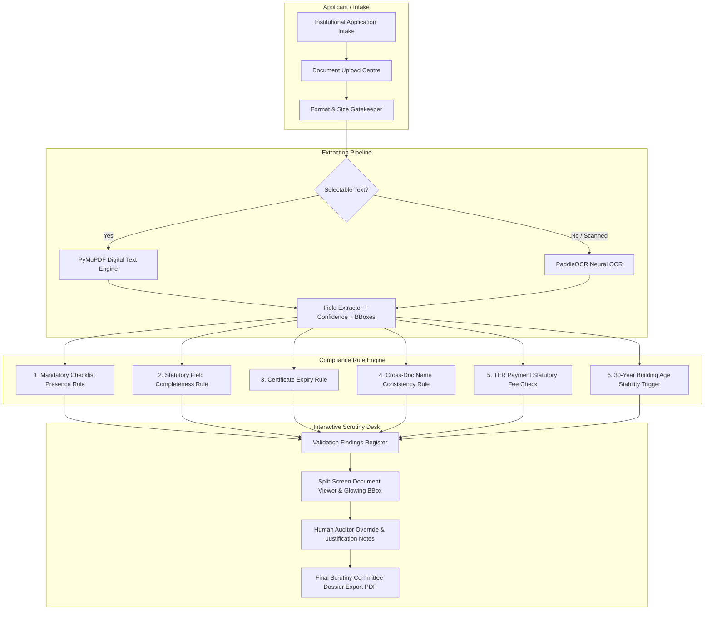

# IMPLEMENTATION_PLAN.md — AICTE Document Compliance & Reviewer Workspace

> **Target:** SIH 2026 Problem Statement 26261  
> **Mission:** Elevate the prototype from a basic passive checker to an **enterprise-grade, evidence-led AICTE Scrutiny Workspace** that wins the hackathon.  
> **Source Rulebook:** AICTE Approval Process Handbook (APH) 2024–2027  
> **Author:** Antigravity Pair Programmer & Core Team  
> **Status:** Ready for Execution  

---

## 1. Executive Summary & Gap Analysis

### 1.1 Where the Project Stands Today
- **Person 1 (Frontend):** Modern, responsive React 18 + Vite UI with custom editorial theme (*"Pramaan Review Workspace"*), animated cursor, status pills, and page flows (`Overview`, `Document Centre`, `Audit Workspace`, `Validation Report`).
- **Person 2 (OCR & Extraction):** PyMuPDF selectable text extractor + PaddleOCR fallback for scanned PDFs/images; heuristic field extractor in `backend/app/ocr/field_extractor.py` with per-field confidence scoring and bounding boxes.
- **Person 3 (Backend & Rules):** FastAPI async application with SQLAlchemy (PostgreSQL / SQLite fallback), four core rule checks (`PRESENCE`, `COMPLETENESS`, `EXPIRY`, `CONSISTENCY`), and confidence threshold handling (`< 0.70` -> `unresolved`).

### 1.2 The Missing Pieces to Win the Hackathon
While the foundation is solid, hackathon judges look for **real-world usability, human-in-the-loop ergonomics, and deep regulatory fidelity**:
1. **The Human-in-the-Loop Review Desk is Passive:** Currently, findings are strictly read-only. A human auditor cannot override a false positive, record justification notes, or officially sign off.
2. **No In-App Document Preview:** When a check flags an issue on page 2, the reviewer cannot view the actual PDF in-app alongside the finding.
3. **Bounding Boxes are Captured but Unused:** OCR extracts `bbox: [x1, y1, x2, y2]`, but the frontend only shows a small text snippet instead of visually highlighting the document.
4. **Unrealized AICTE Handbook Potential:** We currently validate only 3 generic documents. Adding **TER Payment Receipt validation** (Table 2.1 fee schedule) and the **30-Year Building Age Structural Stability Trigger** (Annexure-2 §2.1(iv)) will showcase deep regulatory mastery.
5. **No Deliverable / Scrutiny Dossier Export:** Reviewers need a clean, printable AICTE Scrutiny Committee Report PDF with clause citations and auditor remarks.

---

## 2. Target Architecture & System Workflow



---

## 3. High-Impact Feature Specifications

### Feature 1: Interactive Reviewer Verification Desk (Human-in-the-Loop)
*In compliance scrutiny, algorithms flag, but authorized human reviewers decide.*

#### Backend Changes
1. **Extend `Finding` Model (`backend/app/models/finding.py`):**
   ```python
   reviewer_decision = Column(String(50), nullable=True)  # verified | confirmed_discrepancy | requested_resubmission | escalated
   reviewer_notes = Column(Text, nullable=True)
   reviewed_by = Column(String(100), nullable=True)
   reviewed_at = Column(DateTime(timezone=True), nullable=True)
   ```
2. **Add Endpoint in `backend/app/routes/validation.py`:**
   - `PATCH /api/applications/{application_id}/findings/{finding_id}`
   - Request Body:
     ```json
     {
       "reviewer_decision": "verified",
       "reviewer_notes": "Certificate physically verified against state portal records.",
       "reviewed_by": "Dr. A. Sharma (AICTE Scrutiny Committee)"
     }
     ```
   - Automatically recalculates application `overall_status` taking human verification into account (e.g., if all flagged items are verified by human, status transitions to `ready_for_review`).

#### Frontend UI Integration
- On `/applications/:id/report`, inside each `<Finding />` card:
  - Add an **Auditor Action Bar**:
    - `[✓ Mark Verified / Accept Discrepancy]` (opens quick note modal)
    - `[⚠ Request Document Resubmission]`
    - `[⚑ Escalate to Scrutiny Committee]`
  - Verified findings display an official green badge: `VERIFIED BY AUDITOR` with timestamp and justification note.

---

### Feature 2: Side-by-Side Document Viewer with Visual Evidence Bounding Boxes
*Transform passive reading into an active, visual audit experience.*

#### Backend Changes
1. **Document Streaming Endpoint (`backend/app/routes/documents.py`):**
   - `GET /api/applications/{application_id}/documents/{document_id}/file`
   - Returns `FileResponse` with proper headers (`Content-Type: application/pdf` or image type, `Content-Disposition: inline`).

#### Frontend UI Integration
1. **Interactive Document Viewer Component (`DocumentPreviewModal` or Split View):**
   - When a user clicks **"View in Document"** on any finding or extracted field:
     - Opens the document viewer alongside the finding.
     - Renders the target page.
     - Overlays a semi-transparent, highlighted bounding box (`bbox: [x0, y0, x1, y1]`) pulsing over the exact text snippet (e.g., certificate number, expiry date, or mismatched college name).

---

### Feature 3: AICTE Handbook Rulebook Expansions

#### 3A. TER Payment Receipt & Statutory Fee Check (Annexure-2 §2.1(ii) & Table 2.1)
- **Official Regulation:** Every institution must pay Technical Education Regulatory (TER) charges via the AICTE portal based on institution type:
  - Government / Aided: **₹0.50 Lakh (₹50,000)**
  - Minority (Private Unaided): **₹0.75 Lakh (₹75,000)**
  - Private (Unaided): **₹1.00 Lakh (₹1,00,000)**
  - Standalone (PGDM): **₹1.50 Lakh (₹1,50,000)**
- **Extraction Targets (`ter_payment_receipt`):**
  - `receipt_number`, `transaction_date`, `amount_inr`, `academic_year`.
- **Validation Rule (`TER_PAYMENT_001`):**
  - Verify receipt is present.
  - Verify payment date falls within valid window for academic year `2026-27`.
  - Verify `amount_inr` >= statutory requirement based on institution category.

#### 3B. Building Age -> Structural Stability Conditional Trigger (Annexure-2 §2.1(iv))
- **Official Regulation:** Structural Stability Certificate is required **only if the building is > 30 years old** from the date of the Occupancy/Completion certificate.
- **Validation Rule (`STRUCTURAL_STABILITY_001`):**
  - Extract `issue_date` from `building_completion_certificate`.
  - Calculate: `Building Age = Current Year - Issue Year`.
  - If `Age > 30`: `structural_stability_certificate` becomes **mandatory** (`missing` if not uploaded).
  - If `Age <= 30`: Evaluates to **`not_applicable`** with citation: *"Building is X years old (<= 30 years). Exempt under Annexure-2 §2.1(iv)"*.

---

### Feature 4: One-Click Official AICTE Scrutiny Committee Dossier Export (PDF)
*Provide a tangible, professional output that judges can hold or download.*

- Generates an official printable/downloadable Scrutiny Dossier:
  - **Header:** *"ALL INDIA COUNCIL FOR TECHNICAL EDUCATION — PRELIMINARY SCRUTINY DOSSIER"*
  - **Application Identity:** Reference ID, Institution Name, Academic Year, Category (EoA).
  - **Document Checklist Matrix:** All required documents with presence, date of issue, issuing authority, and verification status.
  - **Compliance Findings Register:** Passed checks, flagged discrepancies, and recorded auditor justification notes.
  - **Sign-off Block:** Signatures of Scrutiny Committee Members, Date, and Final Scrutiny Recommendation.
- Implemented cleanly via browser print styling (`@media print`) and a dedicated export button for zero extra binary dependencies.

---

## 4. Workstream Breakdown & Team Ownership

### Person 1 — Frontend (`frontend/`)
- [ ] Add `PATCH /api/applications/{id}/findings/{findingId}` call to `frontend/src/api.js`.
- [ ] Build `AuditorActionModal` inside `frontend/src/App.jsx` allowing human reviewers to verify/annotate findings.
- [ ] Build `DocumentViewerDrawer` component to preview uploaded PDFs/images directly inside the Document Centre and Report views.
- [ ] Add CSS print stylesheet (`@media print`) for clean "Export Scrutiny Dossier" output.
- [ ] Update Checklist UI to support TER Receipt and conditional Structural Stability.

### Person 2 — OCR & Field Extraction (`backend/app/ocr/`)
- [ ] Add regex patterns for `ter_payment_receipt` (Receipt No, Amount in INR, Transaction Date).
- [ ] Add regex patterns for `structural_stability_certificate` (Registered Engineer Name, License No, Inspection Date).
- [ ] Ensure bounding boxes (`bbox`) are accurately normalized to `[x1, y1, x2, y2]` coordinates relative to page dimensions.
- [ ] Add anchor-word proximity search fallback for non-standard certificate layouts.

### Person 3 — Backend & Validation (`backend/app/`)
- [ ] Add reviewer override columns to `Finding` database model and update migrations.
- [ ] Implement `GET /api/applications/{id}/documents/{doc_id}/file` streaming route in `documents.py`.
- [ ] Implement `PATCH /api/applications/{id}/findings/{finding_id}` endpoint in `validation.py`.
- [ ] Create `TerPaymentRule` checking payment amounts against AICTE Table 2.1 rates.
- [ ] Create `BuildingAgeStructuralStabilityRule` calculating age from Completion Certificate date.
- [ ] Update `calculate_overall_status` to account for reviewer overrides.

---

## 5. Step-by-Step Implementation Roadmap

```mermaid
timeline
    title Step-by-Step Execution Plan
    section Phase 1 : Reviewer Action Desk
        Backend Finding Model & Route : Day 1 Morning
        Frontend Verification & Notes UI : Day 1 Afternoon
    section Phase 2 : Document Viewer & Evidence
        Document File Stream Endpoint : Day 2 Morning
        Side-by-side Viewer with BBoxes : Day 2 Afternoon
    section Phase 3 : AICTE Rulebook Expansion
        TER Payment Rule & Fee Table : Day 3 Morning
        30-Year Building Age Trigger : Day 3 Afternoon
    section Phase 4 : Dossier Export & Polish
        Official Scrutiny PDF Export : Day 4 Morning
        End-to-End Demo Rehearsal : Day 4 Afternoon
```

### Phase 1: Reviewer Verification & Decision Engine (Priority #1)
1. **Database:** Add `reviewer_decision`, `reviewer_notes`, `reviewed_by`, `reviewed_at` to `backend/app/models/finding.py`.
2. **Schemas:** Update `backend/app/schemas/finding.py` to include `FindingReviewUpdate` and updated `FindingResponse`.
3. **Endpoint:** Implement `PATCH /api/applications/{application_id}/findings/{finding_id}` in `validation.py`.
4. **Recalculation:** Update `calculate_overall_status` in `validation_engine.py`: if all flags have `reviewer_decision == "verified"`, mark status as `ready_for_review`.
5. **Frontend UI:** Add interactive auditor actions to `Finding` cards in `App.jsx`.

### Phase 2: Document Serving & Visual Evidence Viewer
1. **File Streaming:** Add `GET /api/applications/{application_id}/documents/{document_id}/file` using FastAPI `FileResponse`.
2. **Frontend Preview:** Add "Inspect Source Evidence" button on findings; opens drawer displaying the document.
3. **Visual Highlight:** Draw a highlight box around the matching `bbox` coordinates.

### Phase 3: AICTE Rulebook Expansions
1. **Update Checklist:** Add `ter_payment_receipt` and conditional `structural_stability_certificate` to `backend/app/checklist/eoa_checklist.py`.
2. **TER Rule:** Implement `backend/app/rules/ter_payment_check.py` validating statutory fees against Table 2.1.
3. **Age Trigger Rule:** Implement `backend/app/rules/building_age_check.py` checking the > 30 years threshold.
4. **Generate Demo PDFs:** Create synthetic `valid_ter_receipt.pdf` and `aged_building_completion.pdf` for seamless demoing.

### Phase 4: Scrutiny Dossier PDF Export & Final Polish
1. **Print Layout:** Add `@media print` CSS stylesheet formatting `/report` into a formal government-style AICTE Scrutiny Dossier.
2. **Export Button:** Add "Export AICTE Scrutiny Dossier (PDF)" triggering `window.print()`.
3. **Demo Script & Rehearsal:** Run all 5 test scenarios (clean pass, expired fire safety, name mismatch, underpaid TER fee, > 30-year building without structural certificate) and verify flawless execution.

---

## 6. Hackathon Pitch & Live Demo Narrative

When presenting to the jury, frame the demo around this compelling narrative:

> *"AICTE receives thousands of Extension of Approval applications every cycle. Scrutiny committees spend hundreds of hours checking whether college names match across 7 different certificates, whether fire NOCs are expired, and if statutory fees were paid.*  
> 
> *Pramaan doesn't replace the committee—it empowers them. Watch what happens when an institution uploads an application with an expired fire certificate and an institution name typo:*
> 1. *In seconds, Pramaan extracts all structured fields with neural OCR and PyMuPDF.*
> 2. *It cross-references AICTE Approval Process Handbook clauses in real time.*
> 3. *It highlights the exact mismatched sentence on page 2 with bounding box evidence.*
> 4. *The human auditor reviews the evidence, adds an official justification note, and generates a formal, signed AICTE Scrutiny Dossier.*
> 
> *Zero guesswork. 100% explainable. Human in complete control."*
