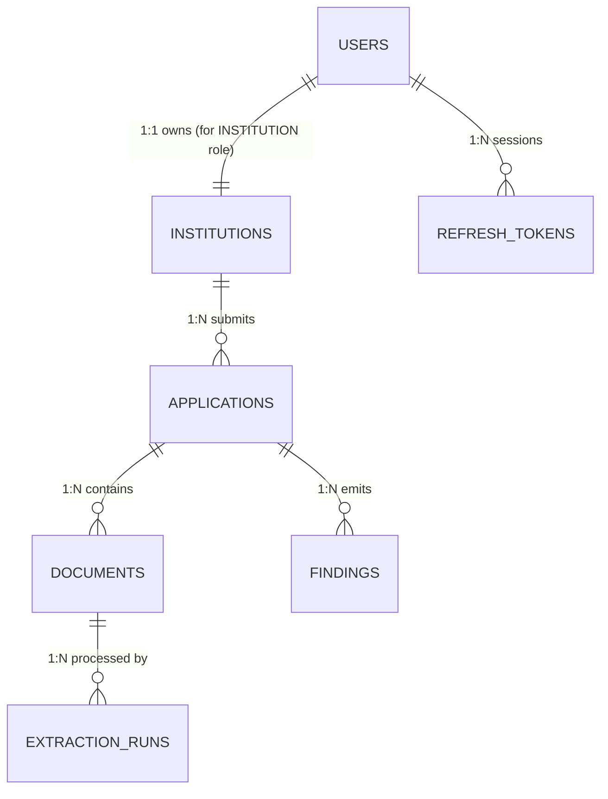
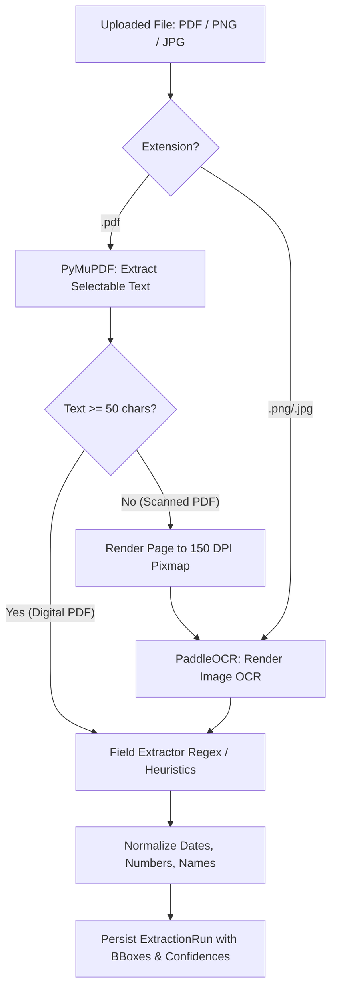
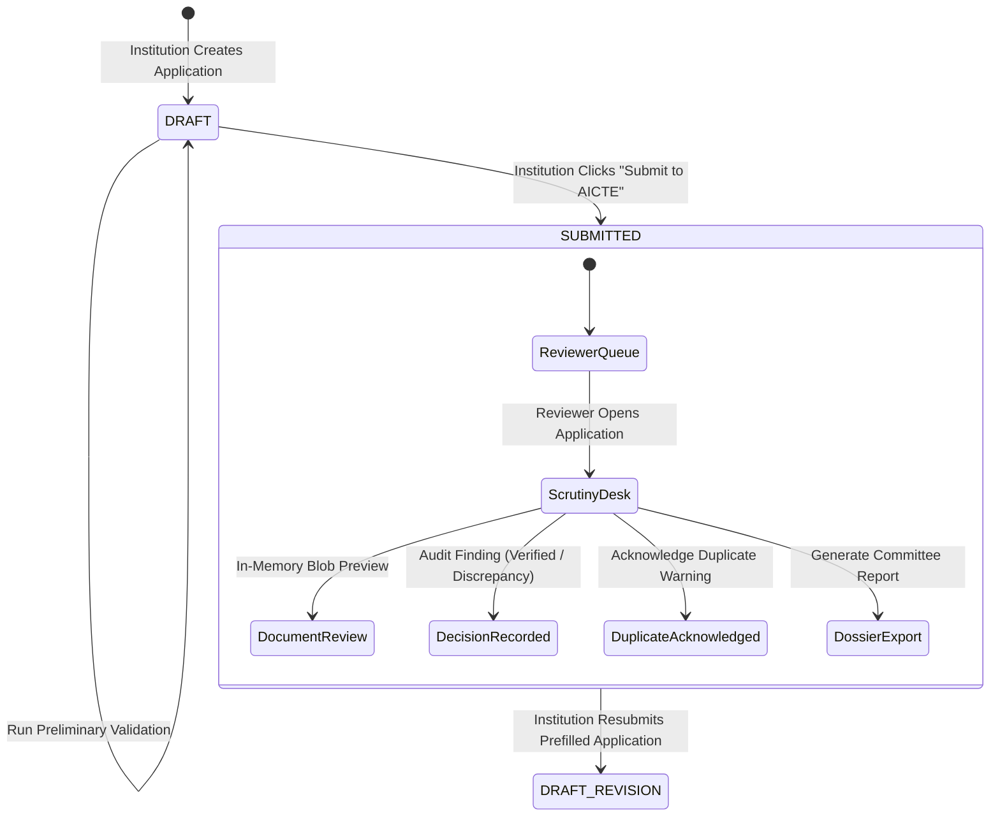

# PROJECT_CONTEXT.md — AICTE Application Scrutiny Prototype ("Pramaan")
**SIH 2026 — Problem Statement 26261**  
*Document Version: 2.1 | Last Synchronized: October 2026*

---

## 1. Executive Summary & Purpose

**Pramaan** is an AI-assisted preliminary application scrutiny and document compliance verification system built for the All India Council for Technical Education (AICTE) under Smart India Hackathon (SIH 2026), Problem Statement 26261.

### Primary Purpose
Every year, technical colleges and universities submit thousands of multi-document applications for Extension of Approval (EoA), New Institutes, and intake expansions. Scrutinizing these applications manually creates severe bottlenecks, human fatigue, and inconsistent enforcement of Approval Process Handbook (APH) norms.

Pramaan automates preliminary scrutiny by:
1. Ingesting institutional applications and required compliance certificates (PDFs and images).
2. Extracting structured key-value pairs using a hybrid OCR pipeline (PyMuPDF for digital text + PaddleOCR for scanned/sparse documents).
3. Executing a deterministic, rule-based compliance engine mapped directly to AICTE APH clauses.
4. Flagging missing documents, expired certificates, fuzzy name mismatches, building age violations, underpaid TER fees, and duplicate document submissions.
5. Providing an evidence-linked audit dossier for AICTE human scrutiny committee reviewers.

> [!IMPORTANT]
> **Regulatory Boundary & Limitation:**  
> Pramaan supports **preliminary scrutiny only**. It does **not** make autonomous legal approval or rejection decisions, does not claim definitive cryptographic forgery detection, and does not replace the statutory authority of the AICTE Scrutiny Committee. It serves as an assistive, evidence-backed accelerator for human auditors.

---

## 2. Technology Stack & Environment

| Layer | Technologies | Key Libraries & Specifications |
| :--- | :--- | :--- |
| **Backend API** | Python 3.11+ / FastAPI | Async FastAPI, SQLAlchemy 2.0 (asyncio), Pydantic v2, Uvicorn |
| **Authentication** | JWT + HTTP-Only Cookies | `python-jose` (HS256), `passlib` (bcrypt), Refresh Token Rotation (RTR) |
| **Database** | PostgreSQL 15+ / SQLite | PostgreSQL (production default), SQLite `aiosqlite` (test harness), Alembic migrations |
| **OCR & Document Engine** | PyMuPDF + PaddleOCR | `pymupdf` (fitz 1.25+), `paddlepaddle 3.3.1`, `paddleocr 3.7.0`, `Pillow`, `numpy` |
| **Frontend SPA** | React 19 + Vite | React Context API, Tailwind CSS, custom aesthetic tokens (`refinement.css`), Lucide icons |
| **Testing** | Pytest + Httpx | `pytest`, `pytest-asyncio`, `httpx`, `freezegun`, `eslint`, Vite bundle runner |

---

## 3. Git Branches & Integration Architecture

The repository is structured around clear workstreams that have been synchronized into `jay-backend`:

```
main (stable upstream baseline)
  │
  ├── origin/aditya-work (Person 2 - OCR, Synthetic Data & Duplicate Detection)
  │     ├── PyMuPDF & PaddleOCR pipeline (app/ocr/)
  │     ├── Duplicate Document Rule (DUPLICATE_DOC_001) & SHA-256 metadata extraction
  │     ├── Synthetic dataset generation (clean, noisy, corrupt, encrypted, multi-page)
  │     └── Reviewer duplicate acknowledgment endpoint
  │
  └── jay-backend (Lead / Full-Stack & Auth Stream — Active Working Branch)
        ├── Alembic migrations (001_baseline_schema, 002_auth_tables)
        ├── User, Institution, RefreshToken models
        ├── Complete Auth & RBAC (INSTITUTION vs REVIEWER roles)
        ├── IDOR tenant protection & lifecycle locking (draft → submitted → review_completed)
        ├── Authenticated document viewer drawer (Blob URLs + ?token= support)
        ├── Scrutiny desk & Reviewer audit workflow
        └── Synchronized merge with origin/aditya-work (all tests 100% passing)
```

---

## 4. Database Schema & Data Models

The persistence layer is managed by **Alembic** with complete async SQLAlchemy 2.0 models:

### 4.1 Migration History
- `d91afcd74a46_baseline_schema.py` (`001`): Creates `applications`, `documents`, `extraction_runs`, `extracted_fields`, and `findings`.
- `d7119ba3049c_auth_tables.py` (`002`): Creates `users`, `institutions`, and `refresh_tokens`.

### 4.2 Entity Relationship Overview



### 4.3 Detailed Model Attributes

#### `users`
- `id` (VARCHAR PK): e.g. `usr_...`
- `email` (VARCHAR, Unique, Indexed): User email address.
- `hashed_password` (VARCHAR): Passlib bcrypt hash.
- `role` (VARCHAR): `INSTITUTION` or `REVIEWER`.
- `is_active` (BOOLEAN): Defaults to `True`.
- `created_at` (TIMESTAMPTZ).

#### `institutions`
- `id` (VARCHAR PK): e.g. `inst_...`
- `user_id` (VARCHAR, Unique FK -> `users.id`): 1:1 user binding.
- `name` (VARCHAR): Official college/institute name (e.g., "Synthetic ABC Engineering College").
- `created_at` (TIMESTAMPTZ).

#### `refresh_tokens`
- `id` (VARCHAR PK): Token record identifier.
- `user_id` (VARCHAR FK -> `users.id`): Owning user.
- `token_hash` (VARCHAR, Unique, Indexed): SHA-256 hash of plaintext refresh token.
- `family_id` (VARCHAR, Indexed): UUID grouping tokens in a rotation sequence.
- `is_revoked` (BOOLEAN): Revocation flag (used for reuse detection).
- `expires_at` (TIMESTAMPTZ): 7-day expiration.
- `created_at` (TIMESTAMPTZ).

#### `applications`
- `id` (VARCHAR PK): e.g. `app_...`
- `institution_name` (VARCHAR): College name matching applicant institution.
- `application_category` (VARCHAR): Default `"eoa"` (Extension of Approval).
- `academic_year` (VARCHAR): Default `"2026-27"`.
- `status` (VARCHAR): Lifecycle state: `"draft"` | `"submitted"` | `"review_completed"`. Institution submission queues the application; only reviewer finalization marks scrutiny complete.
- `overall_status` (VARCHAR): Scrutiny summary: `"valid"` | `"action_required"` | `"missing_documents"` | `"processing_incomplete"`.
- `created_at`, `updated_at` (TIMESTAMPTZ).

#### `documents`
- `id` (VARCHAR PK): e.g. `doc_...`
- `application_id` (VARCHAR FK -> `applications.id`).
- `document_type` (VARCHAR): e.g., `fire_safety_certificate`, `building_completion_certificate`, `affidavit_2`, `ter_payment_receipt`, `structural_stability_certificate`.
- `original_filename` (VARCHAR): Original uploaded file name.
- `stored_filename` (VARCHAR): Disk file name under `backend/uploads/`.
- `mime_type` (VARCHAR): `application/pdf`, `image/png`, `image/jpeg`.
- `file_size_bytes` (INTEGER).
- `file_hash` (VARCHAR): SHA-256 hex digest of file bytes (used for duplicate detection).
- `processing_status` (VARCHAR): `"uploaded"` | `"processing"` | `"processed"` | `"processing_failed"`.
- `created_at` (TIMESTAMPTZ).

#### `extraction_runs`
- `id` (VARCHAR PK): e.g. `run_...`
- `document_id` (VARCHAR FK -> `documents.id`).
- `processing_status` (VARCHAR): `"processed"` | `"processing_failed"`.
- `pages` (JSONB): Extracted page text and region bounding boxes.
- `fields` (JSONB): Structured field dictionary `{field_name: {value, confidence, raw_text, bbox, page_number}}`.
- `error` (VARCHAR): Error string if processing failed.
- `created_at` (TIMESTAMPTZ).

#### `findings`
- `id` (VARCHAR PK): e.g. `finding_...`
- `application_id` (VARCHAR FK -> `applications.id`).
- `document_id` (VARCHAR Nullable FK -> `documents.id`).
- `rule_id` (VARCHAR): e.g. `PRESENCE_001`, `EXPIRY_001`, `CONSISTENCY_001`, `TER_001`, `BUILDING_AGE_001`, `DUPLICATE_DOC_001`.
- `status` (VARCHAR): `"pass"` | `"flagged"` | `"unresolved"`.
- `title` (VARCHAR): Human-readable finding summary.
- `reason` (VARCHAR): Clear legal/handbook rationale.
- `evidence` (JSONB): Extracted snippet, bounding box, page number, confidence, or match details.
- `suggested_action` (VARCHAR): Actionable guidance for applicant or auditor.
- `reviewer_decision` (VARCHAR Nullable): Auditor verification: `"verified"` | `"confirmed_discrepancy"` | `"requested_resubmission"` | `"escalated"`.
- `reviewer_notes` (VARCHAR Nullable): Human auditor notes.
- `reviewed_by` (VARCHAR Nullable): Auditor email or name.
- `reviewed_at` (TIMESTAMPTZ Nullable).

---

## 5. Authentication, Roles & Security (RBAC)

Pramaan enforces a strict security perimeter designed to protect institutional data while providing seamless scrutiny operations for AICTE reviewers:

### 5.1 Role Differentiation

| Feature / Action | `INSTITUTION` Role | `REVIEWER` Role |
| :--- | :--- | :--- |
| **Self-Registration** | Allowed via `/api/auth/register` | **Forbidden** (Seeded by CLI/Admin only) |
| **Application Scope** | Strictly own applications (`institution_name` match) | All **submitted** applications across India |
| **Draft Applications** | Can create, edit, upload docs, validate | **Hidden** (Returns 404 to prevent enumeration) |
| **Application Submission** | Initiates submit (`POST .../submit`) | Receives submitted application in queue |
| **Post-Submission Edits** | **Locked** (409 `APPLICATION_LOCKED`) | Cannot upload or delete college documents |
| **Scrutiny & Re-Validation** | Preliminary check on drafts only | Authorized to re-run scrutiny on submitted apps |
| **Audit Finding Review** | Read-only view of reviewer decisions | Can record decisions (`verified`, `confirmed_discrepancy`, etc.) |
| **Duplicate Acknowledgment** | Cannot override duplicate blocks | Can formally acknowledge duplicate warnings |
| **Resubmission Flow** | Can spawn new revision from prior report | Inspects historical revisions |

### 5.2 Session Management & Tokens
- **Access Tokens:** 60-minute JWT (HS256) holding `sub` (user_id), `role`, `email`, and `institution_id`. Attached via `Authorization: Bearer <token>` or `?token=<token>` query parameter for iframe previews.
- **Refresh Tokens:** 7-day token stored in a secure, HTTP-only, SameSite=Lax cookie.
- **Refresh Token Rotation (RTR):** Every refresh invalidates the current token and issues a new pair. If an invalidated token is reused, the entire token family is immediately revoked (compromised credential containment).
- **Startup Guard:** If `DEBUG=false` in production, the backend strictly refuses to start if `JWT_SECRET_KEY` is using the default development secret.

### 5.3 In-Memory Document Preview Security
Browser iframes and PDF plugins cannot natively send custom `Authorization` HTTP headers. Pramaan implements a dual-defense pattern:
1. **Authenticated Blob Fetching:** The frontend `DocumentViewerDrawer` fetches document bytes via Axios (`GET /api/applications/{id}/documents/{docId}/file`) with the active Bearer token, creates a local in-memory Object URL (`URL.createObjectURL(blob)`), and mounts it into the iframe.
2. **Query Parameter Fallback:** For "Open in new tab", the endpoint accepts `?token=<jwt_access_token>` validated securely via `token_query: str | None = Query(None, alias="token")` in `app/auth/dependencies.py`.

---

## 6. Document Processing Pipeline (PyMuPDF + PaddleOCR)

The extraction engine in `app/ocr/` processes files according to **docs/API_CONTRACT.md section 5**:



### 6.1 Supported Documents & Extracted Fields

| Document Type | AICTE APH Reference | Required Extracted Fields |
| :--- | :--- | :--- |
| `fire_safety_certificate` | APH Annexure 6 Clause 2.1 | `institution_name`, `certificate_number`, `issue_date`, `expiry_date`, `issuing_authority` |
| `building_completion_certificate` | APH Annexure 6 Clause 2.2 | `institution_name`, `certificate_number`, `issue_date`, `building_age`, `issuing_authority` |
| `affidavit_2` | APH Annexure 2 Clause 1.1 | `institution_name`, `affidavit_date`, `notary_registration_number`, `deponent_name` |
| `ter_payment_receipt` | APH Clause 3.4 (Fee norms) | `institution_name`, `receipt_number`, `transaction_date`, `payment_amount` |
| `structural_stability_certificate` | APH Annexure 6 Clause 2.3 | `institution_name`, `certificate_number`, `issue_date`, `engineer_registration_number`, `structure_safety_status` |

---

## 7. Compliance Rules Engine

Validation checks are implemented as deterministic, testable Python classes in `backend/app/rules/`:

1. **`PRESENCE_001` (`DocumentPresenceRule`):**
   - Compares uploaded document types against mandatory checklist for Extension of Approval (EoA).
   - If mandatory certificate missing → status: `missing`, finding status: `flagged`.
2. **`COMPLETENESS_001` (`FieldCompletenessRule`):**
   - Checks if required fields for each document type were extracted.
   - If confidence is below threshold (< 0.70) or field unreadable → status: `unresolved`. Never fabricates data.
3. **`EXPIRY_001` (`ExpiryDateRule`):**
   - Compares certificate `expiry_date` against the application cutoff date (e.g. 2026-04-30).
   - If expired → status: `flagged` with exact date evidence and days expired.
4. **`CONSISTENCY_001` (`InstitutionNameConsistencyRule`):**
   - Executes fuzzy string matching (Levenshtein similarity) between the applicant institution name and the name extracted across all uploaded certificates.
   - Discrepancies > threshold → status: `flagged` with side-by-side snippet evidence.
5. **`TER_001` (`TerPaymentRule`):**
   - Validates Technical Education Regulatory (TER) processing fee receipt against prescribed student intake fee slabs.
   - Underpayment → status: `flagged` with shortfall amount.
6. **`BUILDING_AGE_001` (`BuildingAgeStructuralStabilityRule`):**
   - Checks `building_age` extracted from Building Completion Certificate.
   - If age > 30 years, requires a valid `structural_stability_certificate`.
7. **`DUPLICATE_DOC_001` (`DuplicateDocumentRule`):**
   - Compares SHA-256 file hashes within the same application, across all other applications in the system, and checks for identical certificate numbers across colleges.
   - Flags possible duplicate submissions. Blocks validation report generation (HTTP 409 `DUPLICATES_UNRESOLVED`) until an AICTE reviewer inspects and formally acknowledges the duplicate via `/api/applications/{id}/duplicates/{finding_id}/acknowledge`.

---

## 8. Application Lifecycle & Scrutiny Workflow



### Key Workflow Rules:
1. **Submission Locks Application:** Once submitted, institution uploads or preliminary re-validation return 409 `APPLICATION_LOCKED`.
2. **Reviewer Scrutiny Authority:** Reviewers can re-run scrutiny checks on submitted applications and record decisions with justification notes.
3. **Resubmission Prefill:** Institutions can create a new application pre-populated with verified fields from the prior scrutiny report.

---

## 9. Test Suites & Verification Status

All test suites are active and passing with 100% success rate:

| Test Suite | File | Scope | Status |
| :--- | :--- | :--- | :--- |
| **Auth Enforcement** | `backend/tests/test_auth_enforcement.py` | 19 tests: RBAC, IDOR prevention, application locking, reviewer permissions | **19/19 PASSED** |
| **Features 1 to 3** | `backend/tests/test_features_1_to_3.py` | 4 tests: TER payment, building age stability, reviewer audit recalculation | **4/4 PASSED** |
| **Duplicate Detection** | `backend/tests/test_duplicate_detection.py` | 5 tests: SHA-256 hash match, cross-institution warnings, reviewer acknowledgment | **5/5 PASSED** |
| **Core Validation** | `backend/tests/test_validation.py` | 6 tests: Checklist presence, unextractable fields, expiry, fuzzy name matching | **6/6 PASSED** |
| **Auth & Security** | `backend/tests/test_auth.py` / `test_auth_helpers.py` | 12 tests: JWT lifecycle, RTR rotation, password bcrypt hashing, token endpoints | **12/12 PASSED** |
| **Synthetic OCR** | `backend/tests/evaluate_synthetic_set.py` | 8 evaluation benchmarks: clean, scanned, noisy, corrupt, encrypted, multi-page | **8/8 PASSED** |
| **Frontend Lint & Build** | `frontend/` | ESLint check and Vite production bundle compilation | **0 ERRORS** |

---

## 10. Guidance for AI Agents & Developers

When picking up development in this repository:
1. **Branch Hygiene:** Always develop on or merge into `jay-backend`. Keep commits clean and focused.
2. **Role Awareness:** Any new endpoint must explicitly declare access dependencies (`require_role("INSTITUTION")`, `require_role("REVIEWER")`, or `require_application_access`). Never leave institutional endpoints unscoped.
3. **Application Locking:** Never allow modifications to an application in `submitted` or `review_completed` status by an `INSTITUTION` user. The institute may retrieve the completed scrutiny report only after `review_completed`.
4. **Evidence-Linked Philosophy:** Every validation check must provide raw text, page numbers, and bounding box evidence whenever possible. Low confidence (< 0.70) must become `unresolved`, never a pass.
5. **Running Tests:**
   - Backend: `.\.venv\Scripts\python.exe -m pytest tests/test_auth_enforcement.py tests/test_features_1_to_3.py tests/test_duplicate_detection.py`
   - Frontend: `npm run lint` and `npm run build` in `frontend/`.
