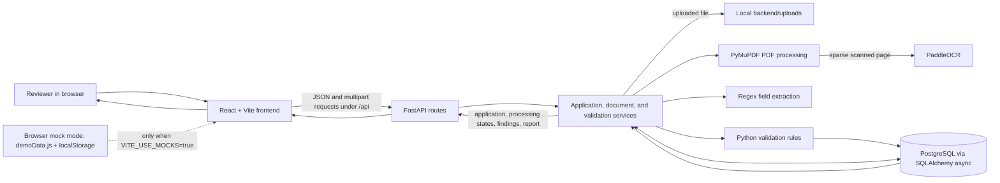

# Project Walkthrough

## 1. Complete User Workflow

### Open the reviewer workspace

Run the FastAPI backend and Vite frontend using the commands in the root [README](../README.md). Open `http://127.0.0.1:5173`. `frontend/src/main.jsx` mounts the React app inside `BrowserRouter`; `frontend/src/App.jsx` defines the Overview, Documents, New Application, per-application Document Centre, Audit Workspace, and Validation Report routes. The Overview lists applications returned by the API. The UI labels whether it is using API mode or synthetic demo data.

The live API is the default. `frontend/src/config.js` reads `VITE_USE_MOCKS` and `VITE_API_BASE_URL`; unless mock mode is explicitly enabled, `frontend/src/api.js` calls the backend at `http://localhost:8000/api`. Mock mode instead reads and writes synthetic records in browser `localStorage` using data in `frontend/src/demoData.js`. It does not upload files to the server or execute backend rules.

### Create the application and add documents

On **New application**, `CreateApplication` in `frontend/src/App.jsx` collects the institution name, one configured category (`eoa`), and academic year. The browser checks that the name is present and the year follows `YYYY-YY`. `createApplication` sends JSON to `POST /api/applications`. The endpoint in `backend/app/routes/applications.py` passes the Pydantic `ApplicationCreate` payload to `application_service.create_application` in `backend/app/services/application_service.py`. That function inserts an `Application` row and initially sets `overall_status` to `processing_incomplete`.

The new record opens at `/applications/{id}/documents`. Its checklist comes from `frontend/src/config.js` and contains the three representative types: `fire_safety_certificate`, `building_completion_certificate`, and `affidavit_2`. The category and checklist are a limited prototype configuration, not the complete set of possible EoA requirements.

The user selects a document type and a PDF, JPG, or PNG. The browser checks the extension/MIME type for a basic match, then `uploadDocument` sends `multipart/form-data` (`file` and `document_type`) to `POST /api/applications/{application_id}/documents`. The server-side checks are authoritative: `backend/app/utils/file_validation.py` accepts PDF/JPG/JPEG/PNG, enforces the configured 10 MB limit, and checks PDF readability and the 20-page limit. `DocumentService.upload_document` in `backend/app/services/document_service.py` verifies the application and selected type, writes the file under `backend/uploads/` by default with a generated name, and inserts document metadata.

### Extract text and fields

The backend runs extraction during the upload request; it is not a separate queued worker. `DocumentService.upload_document` calls `extraction_service.extract` in `backend/app/services/ocr_service.py`, which invokes `process_document` in `backend/app/ocr/processor.py`.

For each PDF page, `process_pdf` in `backend/app/ocr/pdf_processor.py` first asks PyMuPDF for selectable text and text blocks. When a page has fewer than 50 alphanumeric characters, it renders that page at 150 DPI and calls PaddleOCR. JPG and PNG files go directly to PaddleOCR. `backend/app/ocr/ocr_service.py` initializes PaddleOCR 3.x lazily and returns recognized text, confidence values, and bounding boxes. Digital PDF text has no fabricated confidence score.

`extract_fields` in `backend/app/ocr/field_extractor.py` uses document-type-specific regular-expression patterns. It returns fields such as institution name, document number/certificate number, dates, and issuing authority for supported patterns. Dates that parse are normalized to ISO format; raw text is retained as evidence. OCR fields below the configured 0.70 confidence threshold are marked uncertain. These are heuristic extraction results, not verified facts. If no readable text is obtained, processing is marked `processing_failed`; the upload record is still stored and returned with that status. An exception during extraction is caught in the document service and recorded in the extraction run.

### Store and retrieve data

The database models are in `backend/app/models/`:

- `Application` stores the institution, category, academic year, and overall status.
- `Document` stores the selected document type, original and generated filenames, MIME type, size, and processing status.
- `ExtractionRun` stores per-page text/regions, extracted fields, processing status, and any error.
- `Finding` stores each rule result, reason, evidence, and next action.

SQLAlchemy uses PostgreSQL through `asyncpg` by default. `backend/app/database.py` defines the async engine and sessions. On startup, `init_db()` uses SQLAlchemy `create_all` to create missing tables; the code does not run Alembic migrations. The uploaded binary files remain local under `backend/uploads/`; PostgreSQL stores metadata and extraction results rather than the file contents.

The Document Centre reads application details through `GET /api/applications/{application_id}`. `application_service.get_application` returns the record, documents, and latest extraction fields for each document. The frontend also shows checklist presence, processing states, and any returned fields. `GET /api/applications` supplies the overview queue.

### Run validation and read the report

In the Audit Workspace, the user starts validation. `runValidation` in `frontend/src/api.js` calls `POST /api/applications/{application_id}/validate`, then fetches `GET /api/applications/{application_id}/report`. The API routes are in `backend/app/routes/validation.py`; the rules and report assembly are in `backend/app/services/validation_engine.py`.

The engine fetches the application, documents, and latest extraction for each document; removes previous findings for that application; and runs four rules:

1. `DocumentPresenceRule` (`backend/app/rules/presence_check.py`) checks whether each of the three configured types was uploaded.
2. `FieldCompletenessRule` (`backend/app/rules/field_completeness.py`) checks the checklist's required fields for each uploaded supported type.
3. `ExpiryDateRule` (`backend/app/rules/expiry_check.py`) checks expiry only for the Fire Safety Certificate, using the current date unless a test provides a reference date.
4. `InstitutionNameConsistencyRule` (`backend/app/rules/cross_document_check.py`) compares each extracted institution name with the name on the application using normalized token overlap. A similarity of at least 0.70 passes; a lower similarity is flagged. Low-confidence OCR becomes unresolved.

Each finding has a status (`pass`, `flagged`, `missing`, `unresolved`, or `not_applicable`), title, reason, optional document and evidence, and next action. The engine stores the findings, calculates the overall status, and saves it on the application. Its priority is `processing_incomplete`, then `missing_documents`, `discrepancies_found`, `unresolved_checks`, and `checks_passed`. In particular, no documents yields `processing_incomplete` overall even though the report can also list missing required documents.

The report includes `application_id`, `overall_status`, counts by finding status in `summary`, `missing_document_types`, `findings`, and `generated_at`. `ValidationReport` in `frontend/src/App.jsx` displays the overall status, counts, reasons, evidence snippets when provided, and suggested next actions. It does not turn a result into an approval decision.

### Errors and incomplete processing

Unsupported extensions/MIME types, over-size files, invalid PDFs, unknown applications, and unsupported document types produce API errors. The frontend extracts the API error message and shows it in an error notice or upload message. FastAPI error handlers in `backend/app/main.py` return a structured error response and avoid sending stack traces to the browser.

If extraction fails after a file has passed upload checks, the backend keeps the document record, records a failed extraction run, and returns `processing_failed`. Validation does not treat an unprocessed document as a pass: relevant completeness and expiry checks become unresolved. If a required field was not extracted from a processed document, the completeness rule reports it as missing; low OCR confidence is unresolved. A database initialization exception is logged as a startup warning and does not stop the API process, so an available `/health` response by itself is not proof that database-backed operations work.

## 2. System Architecture

### Components and connections



The frontend communicates with FastAPI using `fetch` in `frontend/src/api.js`. Application details and validation reports are JSON; file uploads use multipart form data. FastAPI routes delegate work to services. The document service calls the processing pipeline synchronously, then persists metadata and extraction output through SQLAlchemy. During validation, the engine loads those stored results, evaluates rules, writes findings, updates the application status, and returns the report. The frontend renders the API response.

The browser mock path is separate. It uses `frontend/src/demoData.js` and local storage; its demo validation creates placeholder reviewer findings and does not invoke OCR, PostgreSQL, or the backend validation rules.

### Important implementation files

- `frontend/src/main.jsx`, `frontend/src/App.jsx`: application entry point, navigation, screens, and report rendering.
- `frontend/src/api.js`, `frontend/src/config.js`, `frontend/src/demoData.js`: request functions, live/mock selection, API URL, and synthetic browser data.
- `backend/app/main.py`, `backend/app/routes/`: FastAPI setup, health endpoint, and API endpoints.
- `backend/app/services/application_service.py`, `document_service.py`, `validation_engine.py`: database-backed workflow and report creation.
- `backend/app/ocr/processor.py`, `pdf_processor.py`, `ocr_service.py`, `field_extractor.py`: document processing and field extraction.
- `backend/app/rules/` and `backend/app/checklist/eoa_checklist.py`: actual rules and their configured document/field requirements.
- `backend/app/models/`, `backend/app/schemas/`, `backend/app/database.py`: PostgreSQL tables, API validation models, and database sessions.
- `backend/tests/test_scenarios.py`, `backend/tests/demo_samples/manifest.json`: synthetic scenario tests and expected outcomes.

## 3. Walk Through a Realistic Example

### Synthetic mismatch scenario

The repository has a synthetic case in `backend/tests/test_scenarios.py::test_scenario_5_name_mismatch` and `backend/tests/demo_samples/manifest.json`. The application name is **Synthetic ABC Institute of Technology**. The reviewer uploads all three synthetic PDFs: a Fire Safety Certificate whose text contains a different institution name, a matching Building Completion Certificate, and a matching Affidavit-2. The names and documents are test data, not real institutional records.

The request sequence is:

1. The browser sends the application identity to `POST /api/applications`; the backend stores an `Application` row with initial status `processing_incomplete`.
2. It uploads each PDF to `POST /api/applications/{id}/documents` with its explicit document type. The backend validates and stores each file, extracts text/fields, and saves `Document` and `ExtractionRun` records.
3. It calls `POST /api/applications/{id}/validate`. The presence rule sees all three types. The completeness rule checks the configured fields. The expiry rule checks the Fire Safety expiry date. The consistency rule compares each extracted institution name against the application name.
4. For the fire certificate with a different name, the actual scenario test requires a `CONSISTENCY_001` finding with status `flagged`. The test also asserts overall status `discrepancies_found`. This is a potential mismatch for a reviewer to inspect, not evidence of forgery.
5. The engine saves its findings, calculates status, and returns the report; the frontend fetches it and displays the status and finding details.

The test confirms those two mismatch outcomes; it does not assert a fixed full summary count. This is an excerpt using the actual finding shape and rule output. The bracketed values stand for the runtime values returned by extraction:

```json
{
  "rule_id": "CONSISTENCY_001",
  "status": "flagged",
  "title": "Potential institution name mismatch",
  "reason": "The extracted institution name '[extracted name]' in 'mismatched_fire_safety.pdf' does not closely match '[application name]' (similarity: [calculated percentage]).",
  "document_id": "[uploaded document id]",
  "document_name": "mismatched_fire_safety.pdf",
  "evidence": {
    "page_number": 1,
    "text": "[extracted source text]",
    "field": "institution_name",
    "value": "[extracted name]",
    "bbox": null,
    "similarity_score": "[calculated score]"
  },
  "next_action": "Review the document manually to verify name spelling, change of name approval, or campus variance."
}
```

This is one finding excerpt, not a complete report: the complete response also has `application_id`, `overall_status`, numeric status counts in `summary`, `missing_document_types`, a findings list, and `generated_at`. Bracketed values above are explanatory placeholders; actual responses contain the extraction result, numeric similarity, IDs, and timestamp. A matching name would only pass this specific comparison; neither a match nor a passing report proves authenticity, verifies an issuing authority, or grants AICTE approval.
